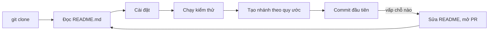

## Bạn sẽ học được gì

- Biết một README tốt cho người mới cần trả lời những câu hỏi nào.
- Viết README theo cấu trúc ngắn gọn: cài đặt, chạy kiểm thử, quy ước nhánh.
- Commit tài liệu như commit mã: xem diff, message rõ, có review.
- Dùng Git để người mới tự định hướng: `git log`, `git grep`, `git log -- <tệp>`.

## Khái niệm

Ngày đầu của một thành viên mới thường xoay quanh ba câu hỏi: "cài gì để chạy được?", "làm sao biết mình không làm hỏng gì?", và "mình nên làm việc trên nhánh nào, đặt tên ra sao?". Nếu repository trả lời được ba câu đó, người mới có thể tự bắt đầu mà không phải đợi ai rảnh.

Nơi tự nhiên nhất cho các câu trả lời là `README.md` ở gốc repository. Gần như mọi nền tảng hosting đều hiển thị tệp này ngay trang đầu, và đây là tệp đầu tiên người ta mở sau khi clone. Một README hữu ích cho onboarding thường có:

- **Giới thiệu một hai câu**: repository này làm gì.
- **Cài đặt**: yêu cầu phiên bản công cụ, lệnh cài phụ thuộc, biến môi trường cần có (không ghi giá trị bí mật).
- **Kiểm thử**: lệnh chạy toàn bộ test, lệnh chạy một phần, kết quả mong đợi.
- **Nhánh**: nhánh chính là gì, đặt tên nhánh làm việc thế nào, merge ra sao.
- **Liên kết**: tới tài liệu sâu hơn như `CONTRIBUTING.md` hay thư mục `docs/`.

Giữ README ngắn. Chi tiết dài nên tách sang `docs/`, README chỉ trỏ tới.

Vì README nằm trong repository, nó có phiên bản như mã. Khi lệnh cài đặt hay quy trình đổi, cập nhật README trong cùng commit (hoặc cùng PR) với thay đổi đó, và cho nó đi qua review như mọi thay đổi khác. Người mới cũng có thể dùng Git để tự tìm hiểu: `git log --oneline` để xem dự án tiến triển ra sao, `git log -- README.md` để xem hướng dẫn đã đổi những gì, `git grep` để tìm nhanh từ khóa.

Một mẹo nhỏ: hãy nhờ chính người mới đi theo README và sửa những chỗ họ vấp. Họ là người kiểm thử tài liệu tốt nhất, và commit đầu tiên của họ có thể chính là sửa README.

## Hình dung bằng sơ đồ



## Lệnh cần biết

```bash
# Xem thay đổi tài liệu trước khi stage
git diff --stat
git diff README.md

# Commit tài liệu
git add README.md
git commit -m "Viết hướng dẫn bắt đầu"

# Người mới tự định hướng
git log --oneline -10
git log --oneline -- README.md
git grep -n -e 'Cài đặt' -e 'Kiểm thử' -e 'Nhánh' -- README.md

# Ai cập nhật hướng dẫn gần nhất, khi nào
git log -1 --format='%h %an %ar' -- README.md
```

## Ví dụ từng bước

Repository bộ kiểm thử chuyển khoản mới chỉ có README một dòng. Bạn viết lại như sau:

```markdown
# Bộ kiểm thử chuyển khoản

## Cài đặt
1. Cài Node.js 20 trở lên.
2. Chạy `npm ci`.

## Kiểm thử
- Chạy toàn bộ: `npm test`.
- Chạy một bộ: `npm test -- chuyen-khoan`.

## Nhánh
- Nhánh chính: `main`, luôn xanh.
- Nhánh làm việc: `qa/<mã-ticket>-<mô-tả>`.
```

(Các lệnh `npm` ở đây chỉ là nội dung minh họa trong README, mình không chạy chúng.) Kiểm tra rồi commit (ID trên máy bạn sẽ khác):

```bash
git diff --stat
git add README.md
git commit -m "Viết hướng dẫn bắt đầu"
```

```text
 README.md | 14 +++++++++++++-
 1 file changed, 13 insertions(+), 1 deletion(-)
[main 74bac6f] Viết hướng dẫn bắt đầu
 1 file changed, 13 insertions(+), 1 deletion(-)
```

Kiểm tra nhanh ba mục có mặt:

```bash
git grep -n -e 'Cài đặt' -e 'Kiểm thử' -e 'Nhánh' -- README.md
```

```text
README.md:3:## Cài đặt
README.md:7:## Kiểm thử
README.md:11:## Nhánh
README.md:12:- Nhánh chính: `main`, luôn xanh.
README.md:13:- Nhánh làm việc: `qa/<mã-ticket>-<mô-tả>`.
```

Người mới clone về và tự xem lịch sử của hướng dẫn:

```bash
git log --oneline -- README.md
git log -1 --format='%h %an %ar' -- README.md
```

```text
74bac6f Viết hướng dẫn bắt đầu
73a94f7 Khởi tạo
74bac6f Duy 5 seconds ago
```

Họ biết README vừa được cập nhật và biết hỏi ai nếu có thắc mắc.

> **Mẹo** Khi trích từ khóa có dấu cách cho `git grep -e`, nhớ bọc trong nháy. Không có nháy, shell tách "Kiểm thử" thành hai đối số và Git sẽ hiểu chữ thứ hai là tên revision.

## Lỗi thường gặp

**README chỉ có tên dự án.** Người mới phải hỏi từng bước, tốn thời gian của cả nhóm.

**Hướng dẫn lỗi thời.** Lệnh cài đặt đã đổi nhưng README không đổi. Cập nhật README cùng commit hoặc cùng PR với thay đổi.

**Ghi mật khẩu, token mẫu thật vào README.** Tài liệu nằm trong lịch sử Git vĩnh viễn. Chỉ ghi tên biến môi trường và nơi xin giá trị.

**Viết quá dài.** Không ai đọc hết. Tách chi tiết sang `docs/`.

> **Lưu ý** Nhiều nền tảng hosting nhận README ở gốc repository và hiển thị ngay. Tên tệp `README.md` (chữ hoa, đuôi `.md`) là quy ước phổ biến nhất.

## Áp dụng trong công việc

Nhóm QA nhận ba kỹ sư thực tập cùng lúc. Thay vì kèm từng người, bạn viết README ba mục, rồi giao nhiệm vụ đầu tiên: làm theo README trên máy mới và mở PR sửa mọi chỗ chưa rõ. Cuối tuần, README đã được ba người mới "kiểm thử" và cải thiện, sẵn sàng cho đợt sau.

## Chuẩn bị làm bài

Bài thực hành có repository với một commit ban đầu. Bạn cần viết lại tệp hướng dẫn bắt đầu ở gốc repository sao cho có đủ ba mục mà đề bài nêu, rồi commit để working tree sạch. Nội dung từng mục do bạn tự viết; trình kiểm tra chỉ xem các mục có mặt trong commit mới. Câu hỏi kiến thức hỏi tệp nào nên chứa hướng dẫn bắt đầu dự án.

## Tóm tắt

- Người mới cần biết: cài gì, chạy test thế nào, làm việc trên nhánh nào.
- README ở gốc repository là nơi đầu tiên họ đọc.
- Giữ README ngắn, trỏ sang `docs/` cho chi tiết.
- Cập nhật tài liệu cùng thay đổi và cho đi qua review.
- Nhờ người mới đi theo README và sửa chỗ vấp.
