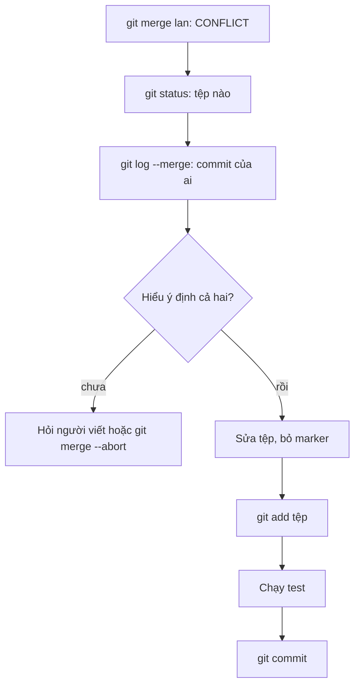

## Bạn sẽ học được gì

- Xác định nhanh tệp nào đang conflict và ai đã tạo ra hai phía của nó.
- Đọc conflict có cả phần base để hiểu ý định của từng người.
- Hoàn tất merge đúng quy trình: sửa tệp, `git add`, kiểm tra, commit.
- Biết khi nào nên hỏi đồng nghiệp thay vì tự chọn một bên.

## Khái niệm

Conflict không phải là lỗi của Git hay của ai cả. Nó chỉ có nghĩa: hai người đã sửa cùng một vùng theo hai cách khác nhau, và Git không đủ thông tin để biết kết quả đúng. Người biết đúng là những người đã viết hai thay đổi đó.

Vì vậy, giải quyết conflict trong nhóm là việc hiểu **ý định** của cả hai phía, chứ không chỉ chọn "của mình" hay "của họ". Ví dụ Lan cập nhật mức phí theo biểu phí mới, còn Minh thêm điều kiện miễn phí. Cả hai thay đổi đều đúng; kết quả mong muốn rất có thể là kết hợp cả hai. Chọn một bên sẽ làm mất công việc và ý định của người kia.

Quy trình gọn:

1. **Nhận diện**: `git status` hoặc `git diff --name-only --diff-filter=U` liệt kê tệp còn conflict.
2. **Tìm người liên quan**: `git log --merge` chỉ liệt kê các commit chạm vào tệp đang conflict, từ cả hai phía. Bạn biết cần hỏi ai.
3. **Hiểu ý định**: xem conflict ở kiểu `diff3` để thấy cả bản gốc. Đọc message của hai commit.
4. **Sửa tệp**: viết nội dung cuối, bỏ hết marker.
5. **Đánh dấu đã giải quyết**: `git add <tệp>`. Lệnh này gộp các stage conflict trong index thành một entry bình thường.
6. **Kiểm tra**: chạy test, xem lại `git diff --cached`.
7. **Hoàn tất**: `git commit`, ghi rõ trong message bạn đã giải quyết thế nào, và ai đã xác nhận.

Nếu chưa thể quyết định (cần chờ người kia), `git merge --abort` đưa repository về trạng thái trước khi merge, không mất gì.

## Hình dung bằng sơ đồ



## Lệnh cần biết

```bash
# Tệp còn conflict
git status --short
git diff --name-only --diff-filter=U

# Commit hai phía chạm vào tệp conflict
git log --merge --oneline

# Viết lại marker có phần base
git checkout --conflict=diff3 phi.txt

# Diff trong lúc merge (combined diff)
git diff

# Đánh dấu đã giải quyết, rồi hoàn tất
git add phi.txt
git commit

# Hủy merge, quay về trước khi merge
git merge --abort
```

## Ví dụ từng bước

`phi.txt` có dòng "phí liên ngân hàng: 3300". Trên nhánh `lan`, Lan đổi thành 5500. Trên main, Minh thêm "(miễn phí dưới 500k)". Merge (ID trên máy bạn sẽ khác):

```bash
git merge lan
git status --short
```

```text
Auto-merging phi.txt
CONFLICT (content): Merge conflict in phi.txt
Automatic merge failed; fix conflicts and then commit the result.
UU phi.txt
```

`UU` nghĩa là cả hai phía đều sửa. Ai đã sửa?

```bash
git log --merge --oneline --format="%h %an %s"
```

```text
4876428 Minh Minh thêm điều kiện miễn phí
40f33e9 Lan Lan cập nhật phí theo biểu mới
```

Xem conflict có phần base:

```bash
git checkout --conflict=diff3 phi.txt
cat phi.txt
```

```text
Recreated 1 merge conflict
phí nội bộ: 0
<<<<<<< ours
phí liên ngân hàng: 3300 (miễn phí dưới 500k)
||||||| base
phí liên ngân hàng: 3300
=======
phí liên ngân hàng: 5500
>>>>>>> theirs
```

So với base, Minh thêm điều kiện, Lan đổi con số. Sau khi nhắn hỏi và cả hai xác nhận, bạn viết dòng kết hợp "phí liên ngân hàng: 5500 (miễn phí dưới 500k)". Combined diff cho thấy kết quả so với từng phía:

```bash
git diff
```

```text
diff --cc phi.txt
index 57a5d53,7d29962..0000000
--- a/phi.txt
+++ b/phi.txt
@@@ -1,2 -1,2 +1,2 @@@
  phí nội bộ: 0
- phí liên ngân hàng: 3300 (miễn phí dưới 500k)
 -phí liên ngân hàng: 5500
++phí liên ngân hàng: 5500 (miễn phí dưới 500k)
```

Hai cột dấu ở đầu dòng ứng với hai phía. `++` là dòng mới so với cả hai. Đánh dấu đã giải quyết và commit:

```bash
git add phi.txt
git status --short
git commit --no-edit
git log --oneline --graph
```

```text
M  phi.txt
[main 0f31ea9] Merge branch 'lan'
*   0f31ea9 Merge branch 'lan'
|\  
| * 40f33e9 Lan cập nhật phí theo biểu mới
* | 4876428 Minh thêm điều kiện miễn phí
|/  
* e5914bf Bảng phí
* 71ba08d Khởi tạo
```

Merge commit có hai parent, chứa thay đổi của cả hai người.

> **Lưu ý** Ở ví dụ trên, `--no-edit` giữ nguyên message mặc định, kể cả các dòng `# Conflicts:` mà Git gợi ý. Kiểm tra bằng `git log -1 --format=%B` sẽ thấy chúng. Trong công việc thật, hãy chạy `git commit` không kèm `--no-edit` để mở editor và ghi rõ cách giải quyết.

## Lỗi thường gặp

**Chọn "của mình" cho nhanh.** Mất thay đổi của đồng nghiệp mà họ không biết.

**Quên một marker.** Tệp còn `<<<<<<<` vẫn được commit nếu bạn `git add`. Tìm lại bằng `git diff --check` hoặc tìm chuỗi `<<<<<<<` trước khi add.

**Commit mà không chạy test.** Kết hợp hai thay đổi đúng vẫn có thể ra kết quả sai.

**Hoảng và xóa thư mục, clone lại.** Chỉ cần `git merge --abort`.

> **Mẹo** Bật `git config --global merge.conflictStyle zdiff3` để lần conflict nào cũng có phần base, không cần chạy `git checkout --conflict=diff3`.

## Áp dụng trong công việc

Hai QA cùng sửa tệp dữ liệu kiểm thử biểu phí. Khi merge bị conflict, bạn không đoán. Bạn dùng `git log --merge` để biết hai commit liên quan, nhắn cả hai người trong kênh của nhóm, chia sẻ phần conflict dạng `diff3`, và ghi tóm tắt quyết định vào message merge commit. Ai đọc lịch sử sau này cũng hiểu vì sao dòng đó có dạng như vậy.

## Chuẩn bị làm bài

Bài thực hành mở ra khi repository đang ở giữa một merge bị conflict ở một tệp lời chào. Đề yêu cầu giữ ý định của cả hai phía, bỏ marker và hoàn tất merge để có merge commit với hai parent, working tree sạch. Câu hỏi kiến thức hỏi bước Git tiếp theo ngay sau khi bạn đã sửa xong tệp conflict.

## Tóm tắt

- Conflict là lúc Git cần con người quyết định; người hiểu ý định là người viết.
- `git status` và `git log --merge` cho biết tệp nào và ai liên quan.
- `diff3` hoặc `zdiff3` cho thấy bản gốc, giúp hiểu mỗi bên đã đổi gì.
- Sửa tệp, `git add`, chạy test, rồi `git commit` với message rõ ràng.
- Chưa chắc thì `git merge --abort` và hỏi lại.
