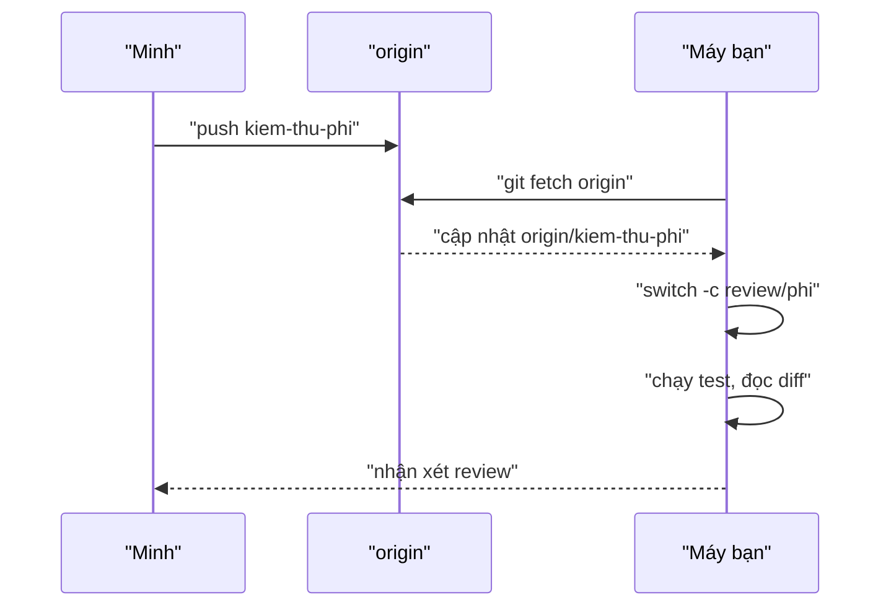
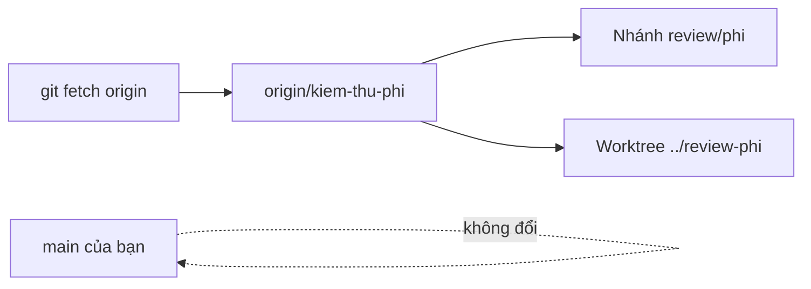

## Bạn sẽ học được gì

- Tải nhánh của đồng nghiệp về máy mà không đụng tới nhánh đang làm.
- Tạo nhánh review local từ remote-tracking ref và chạy thử thay đổi.
- Dùng `git worktree` để review song song mà không phải stash hay commit dở.
- Dọn dẹp sau khi review xong.

## Khái niệm

Đọc diff trên giao diện web là bước đầu, nhưng nhiều lỗi chỉ lộ ra khi chạy: test thất bại, script thiếu quyền thực thi, cấu hình sai đường dẫn. Review tốt thường gồm cả việc tải nhánh về và chạy thử trong môi trường an toàn.

Quy trình gồm ba ý:

1. **Fetch**: `git fetch origin` tải commit và ref mới từ origin về, cập nhật các remote-tracking ref như `origin/kiem-thu-phi`. Fetch không đụng tới nhánh local và working tree của bạn, nên luôn an toàn.
2. **Mở nhánh để xem**: tạo một nhánh local từ remote-tracking ref, ví dụ `git switch -c review/phi origin/kiem-thu-phi`. Đặt tiền tố `review/` giúp phân biệt với nhánh của chính bạn. Nếu chỉ cần xem, `git switch --detach origin/kiem-thu-phi` cũng được.
3. **Chạy thử và so sánh**: chạy test, đọc `git log main..origin/kiem-thu-phi` và `git diff main...origin/kiem-thu-phi`.

Nếu bạn đang làm dở việc khác, `git worktree add` tạo một thư mục làm việc thứ hai dùng chung repository: bạn review ở thư mục đó, còn thư mục chính giữ nguyên trạng thái. Xong thì `git worktree remove`.

Một tiện ích nhỏ: nếu chưa có nhánh local tên `kiem-thu-phi` mà có đúng một remote có nhánh đó, `git switch kiem-thu-phi` tự tạo nhánh local theo dõi `origin/kiem-thu-phi`.

## Hình dung bằng sơ đồ





## Lệnh cần biết

```bash
# Tải ref mới, không merge
git fetch origin

# Nhánh có trên remote
git branch -r

# Commit sẽ được thêm vào main
git log --oneline main..origin/kiem-thu-phi

# Mở nhánh review local
git switch -c review/phi origin/kiem-thu-phi

# Hoặc review ở thư mục riêng
git worktree add ../review-phi origin/kiem-thu-phi
git worktree remove ../review-phi

# Dọn nhánh review
git branch -D review/phi
```

## Ví dụ từng bước

Minh đã push nhánh `kiem-thu-phi` lên origin. Trên máy bạn, origin chưa có gì mới (ID trên máy bạn sẽ khác):

```bash
git branch -r
git fetch origin
git branch -r
```

```text
  origin/HEAD -> origin/main
  origin/main
From /tmp/pb/x/tw3/origin
 * [new branch]      kiem-thu-phi -> origin/kiem-thu-phi
  origin/HEAD -> origin/main
  origin/kiem-thu-phi
  origin/main
```

(Đường dẫn trong dòng "From" là của máy thử nghiệm.) Xem nhánh mang gì vào:

```bash
git log --oneline main..origin/kiem-thu-phi
```

```text
cb388c4 Thêm test phí
```

Mở nhánh review và chạy thử:

```bash
git switch -c review/phi origin/kiem-thu-phi
./test.sh
```

```text
Switched to a new branch 'review/phi'
branch 'review/phi' set up to track 'origin/kiem-thu-phi'.
3 test qua
```

Cách thứ hai, không rời nhánh hiện tại: dùng worktree.

```bash
git switch main
git worktree add ../review-phi origin/kiem-thu-phi
ls ../review-phi
git worktree remove ../review-phi
```

```text
Switched to branch 'main'
Your branch is up to date with 'origin/main'.
Preparing worktree (detached HEAD cb388c4)
HEAD is now at cb388c4 Thêm test phí
README.md
test.sh
```

Worktree ở trạng thái detached HEAD vì bạn chỉ định remote-tracking ref, không phải tên nhánh local. Với việc chỉ xem và chạy thử, như vậy là đủ.

> **Cẩn thận** Chạy mã của người khác nghĩa là tin script đó. Với thay đổi lạ hoặc từ nguồn bên ngoài, hãy đọc script trước khi chạy và chạy trong môi trường thử nghiệm, không chạy trên máy có dữ liệu thật hay quyền truy cập hệ thống sản xuất.

## Lỗi thường gặp

**Dùng `git pull` để "xem" nhánh người khác.** Pull merge vào nhánh hiện tại của bạn. Để xem, chỉ cần fetch.

**Review bản cũ.** Quên fetch lại sau khi tác giả push sửa đổi. Fetch trước mỗi vòng review.

**Sửa trực tiếp trên nhánh review rồi push nhầm lên nhánh của tác giả.** Nếu muốn đề xuất sửa, hãy ghi nhận xét hoặc thống nhất trước với tác giả.

**Để lại hàng chục nhánh `review/...`.** Dọn sau mỗi lần review bằng `git branch -D`.

> **Mẹo** `git fetch --prune` vừa tải mới vừa xóa remote-tracking ref của nhánh đã bị xóa trên remote, giữ danh sách `git branch -r` gọn gàng.

## Áp dụng trong công việc

Minh thêm bộ test cho phí chuyển khoản. Trên web, diff trông ổn. Bạn fetch, mở worktree, chạy thử và phát hiện script test gọi một đường dẫn chỉ có trên máy Minh. Bạn ghi nhận xét kèm lệnh tái hiện, Minh sửa trước khi merge. Lỗi được bắt ở review thay vì ở pipeline đêm.

## Chuẩn bị làm bài

Bài thực hành dùng origin local. Nhánh tính năng chỉ có trên origin, chưa có ở máy bạn. Bạn cần tải nhánh về, tạo nhánh review local tên theo đề bài trỏ đúng commit của nhánh tính năng, giữ main nguyên và working tree sạch. Câu hỏi kiến thức hỏi lệnh tải ref từ origin trước khi checkout.

## Tóm tắt

- Fetch tải ref mới mà không đụng tới nhánh local và working tree.
- Tạo nhánh `review/...` từ remote-tracking ref để chạy thử.
- `git worktree` cho phép review song song với công việc đang dở.
- Đọc script trước khi chạy và chạy trong môi trường thử nghiệm.
- Dọn nhánh và worktree review sau khi xong.
