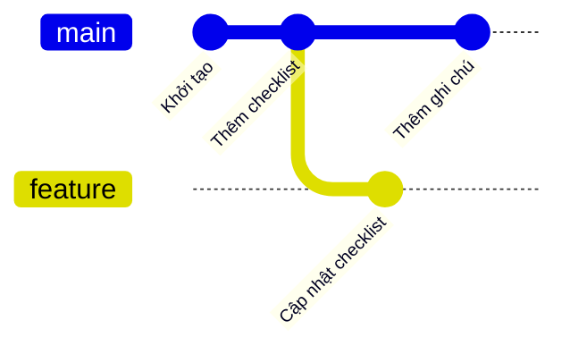
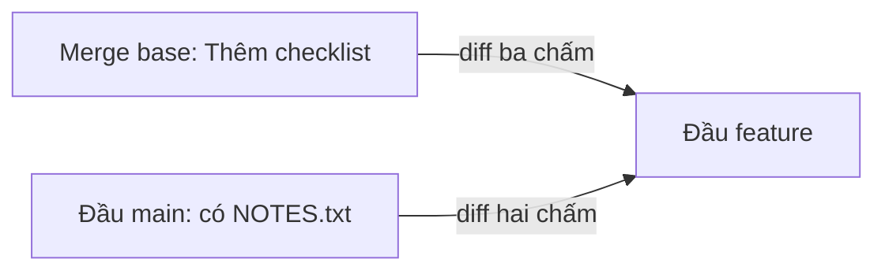

## Bạn sẽ học được gì

- Phân biệt diff hai chấm (`main..feature` hay `main feature`) và ba chấm (`main...feature`) khi review.
- Chọn đúng kiểu diff để chỉ thấy thay đổi của nhánh đang được review.
- Dùng `--stat`, `--name-status`, `--word-diff` để đọc nhanh mà vẫn kỹ.
- Có một quy trình review gọn: đọc mục tiêu, xem danh sách commit, xem diff, kiểm tra dòng bị xóa.

## Khái niệm

Review code về bản chất là đọc diff: những gì nhánh của đồng nghiệp sẽ mang vào main. Câu hỏi then chốt là: so với cái gì?

`git diff main feature` (tương đương `git diff main..feature`) so trực tiếp snapshot đầu main với snapshot đầu feature. Nếu main đã có thêm commit sau khi feature tách ra, những commit đó cũng hiện trong diff, nhưng dưới dạng "bị xóa" vì feature chưa có chúng. Người review dễ hoảng: "sao nhánh này xóa NOTES.txt?". Thật ra nhánh đó không đụng tới NOTES.txt.

`git diff main...feature` (ba chấm) so **merge base** của hai nhánh với đầu feature. Nói cách khác: "feature đã làm gì kể từ lúc tách khỏi main". Đây gần như luôn là thứ bạn muốn khi review, và cũng là cách phần lớn nền tảng hosting hiển thị diff của pull request.

Lưu ý dấu chấm có nghĩa khác nhau giữa `git log` và `git diff`:

| Lệnh | Ý nghĩa |
| --- | --- |
| `git log main..feature` | Commit có trong feature mà main chưa có |
| `git log main...feature` | Commit có ở đúng một trong hai bên |
| `git diff main feature` hoặc `main..feature` | So hai snapshot đầu nhánh |
| `git diff main...feature` | So merge base với đầu feature |

Một bài review tốt không chỉ nhìn dòng thêm mới. Dòng bị xóa thường ẩn rủi ro lớn hơn: một bước kiểm tra bị bỏ, một điều kiện bị nới, một test bị xóa. Hãy đối chiếu từng thay đổi với mục tiêu của nhánh: có thay đổi nào không liên quan? Có gì thiếu so với mô tả?

## Hình dung bằng sơ đồ





Diff ba chấm bắt đầu từ merge base nên không lẫn commit "Thêm ghi chú" của main.

## Lệnh cần biết

```bash
# Commit sẽ được mang vào main
git log --oneline main..feature

# Thay đổi của feature kể từ khi tách khỏi main
git diff main...feature

# Tóm tắt theo tệp
git diff --stat main...feature
git diff --name-status main...feature

# Thấy rõ thay đổi trong một dòng
git diff --word-diff main...feature

# Bỏ qua thay đổi chỉ do khoảng trắng
git diff -w main...feature

# Xem từng commit kèm diff
git log -p main..feature
```

## Ví dụ từng bước

Main có commit "Thêm ghi chú" (tạo `NOTES.txt`) sau khi feature tách ra. Feature sửa `checklist.txt` (ID trên máy bạn sẽ khác):

```bash
git log --oneline --graph --all
```

```text
* 6e0476a Cập nhật checklist
| * cde963a Thêm ghi chú
|/  
* 4be27fb Thêm checklist
* 37057fc Khởi tạo
```

So hai kiểu:

```bash
git diff --stat main feature
git diff --stat main...feature
```

```text
 NOTES.txt     | 1 -
 checklist.txt | 3 ++-
 2 files changed, 2 insertions(+), 2 deletions(-)
 checklist.txt | 3 ++-
 1 file changed, 2 insertions(+), 1 deletion(-)
```

Kiểu hai chấm khiến feature trông như xóa `NOTES.txt`. Kiểu ba chấm chỉ còn đúng thay đổi của feature. Liệt kê commit cần review, rồi đọc diff:

```bash
git log --oneline main..feature
git diff main...feature
```

```text
6e0476a Cập nhật checklist
diff --git a/checklist.txt b/checklist.txt
index 3351ce1..980de68 100644
--- a/checklist.txt
+++ b/checklist.txt
@@ -1,2 +1,3 @@
 Kiểm tra số dư
-Kiểm tra hạn mức
+Kiểm tra hạn mức mới
+Kiểm tra phí chuyển khoản
```

Dòng "Kiểm tra hạn mức" bị thay. Diff theo dòng khiến bạn phải so bằng mắt; `--word-diff` chỉ ra chính xác chữ nào mới:

```bash
git diff --word-diff main...feature
```

```text
@@ -1,2 +1,3 @@
Kiểm tra số dư
Kiểm tra hạn mức {+mới+}
{+Kiểm tra phí chuyển khoản+}
```

(Phần header của diff đã được lược bớt.) Giờ câu hỏi review rõ ràng: "hạn mức mới" là gì, có tài liệu nào mô tả không?

> **Mẹo** Bắt đầu mỗi lần review bằng `git log --oneline main..feature` và `git diff --stat main...feature`. Hai lệnh này cho bạn bản đồ trước khi đi vào chi tiết.

## Lỗi thường gặp

**Dùng diff hai chấm khi main đã đi tiếp.** Bạn sẽ thấy thay đổi giả, như ví dụ `NOTES.txt` ở trên.

**Nhầm nghĩa ba chấm giữa log và diff.** Với log, ba chấm là "khác biệt đối xứng"; với diff, ba chấm là "từ merge base".

**Chỉ đọc dòng thêm.** Dòng bị xóa có thể là test hay bước kiểm tra quan trọng.

**Review trên nhánh local cũ.** Hãy `git fetch` trước, so với `origin/main` và `origin/feature` để chắc chắn đang đọc bản mới nhất.

> **Lưu ý** Diff ba chấm không cho biết merge có conflict hay không, cũng không cho thấy kết quả cuối sau khi ghép với main mới. Muốn kiểm tra điều đó, hãy thử merge trên nhánh tạm hoặc dùng `git merge-tree --write-tree`.

## Áp dụng trong công việc

Bạn review nhánh cập nhật checklist kiểm thử cho luồng chuyển khoản. `git diff --stat main...feature` cho thấy ngoài checklist còn một tệp cấu hình môi trường test bị sửa. Mô tả nhánh không nhắc tới tệp đó, nên bạn để lại nhận xét hỏi lý do thay vì duyệt luôn.

## Chuẩn bị làm bài

Đây là bài trả lời câu hỏi, không có repository thực hành. Câu hỏi hỏi lệnh xem diff giữa main và feature tính từ merge base. Ôn lại bảng so sánh hai chấm và ba chấm, chú ý thứ tự tên nhánh.

## Tóm tắt

- Review là đọc thay đổi mà nhánh sẽ mang vào main.
- Diff ba chấm so merge base với đầu nhánh, tránh thay đổi giả từ main.
- Dấu chấm có nghĩa khác nhau giữa `git log` và `git diff`.
- `--stat`, `--name-status`, `--word-diff`, `-w` giúp đọc nhanh và chính xác.
- Luôn đối chiếu thay đổi với mục tiêu và đọc kỹ dòng bị xóa.
