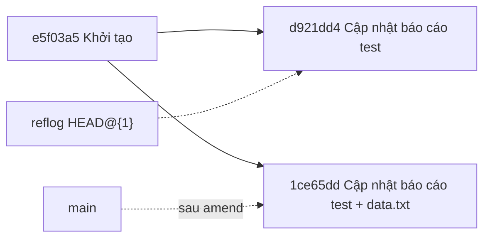
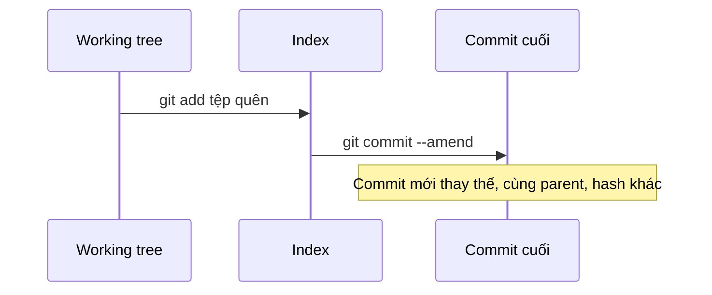

## Bạn sẽ học được gì

- Hiểu `git commit --amend` thật ra làm gì với commit cuối.
- Bổ sung tệp quên stage vào commit vừa tạo mà không sinh commit mới.
- Biết vì sao amend một commit đã push gây rắc rối, và cách xử lý.
- Hoàn tác một lần amend nhầm bằng reflog.

## Khái niệm

Bạn vừa commit "Cập nhật báo cáo test" thì nhận ra quên một tệp dữ liệu đi kèm. Tạo thêm commit "Quên thêm tệp" thì lịch sử lộn xộn; điều bạn muốn là commit vừa rồi **giống như đã có tệp đó từ đầu**. Đó là việc của `git commit --amend`.

Điều quan trọng cần hiểu: commit trong Git **không thể sửa**. Hash của commit được tính từ nội dung của nó (tree, parent, tác giả, thời gian, message), nên đổi bất cứ gì cũng ra hash khác. Vì vậy amend không "sửa" commit cũ. Nó:

1. Lấy index hiện tại (gồm cả những gì bạn vừa stage thêm) làm tree mới.
2. Tạo một commit **mới** có cùng parent với commit cuối.
3. Dời nhánh sang commit mới. Commit cũ không còn được nhánh trỏ tới, nhưng vẫn nằm trong reflog một thời gian.

Kết quả: số commit trên nhánh không đổi, nhưng hash commit cuối thay đổi. Mặc định, Git mở editor để bạn xem lại message; `--no-edit` giữ nguyên message cũ, `-m "..."` thay message mới. Tác giả và ngày tác giả (author date) được giữ theo commit gốc, còn committer date là thời điểm amend. Output của amend in thêm dòng `Date:` để nhắc bạn rằng ngày tác giả lấy từ commit cũ.

Vì hash đổi, amend là **viết lại lịch sử**. Nếu commit cũ đã được push và người khác đã dựa trên nó, nhánh của bạn và remote sẽ phân kỳ: remote có commit cũ, bạn có commit mới thay thế. Push bình thường sẽ bị từ chối, và muốn đẩy lên thì phải force push, ảnh hưởng tới đồng nghiệp. Quy tắc an toàn: **chỉ amend commit chưa chia sẻ**. Nếu đã push lên một nhánh chung, hãy tạo commit bổ sung.

## Hình dung bằng sơ đồ





## Lệnh cần biết

```bash
git add <tệp>                 # stage phần cần bổ sung
git commit --amend            # tạo commit thay thế, mở editor cho message
git commit --amend --no-edit  # giữ nguyên message
git commit --amend -m "..."   # đổi luôn message
git commit --amend --reset-author --no-edit   # cập nhật tác giả và ngày theo cấu hình hiện tại
git reset --soft HEAD@{1}     # hoàn tác lần amend, giữ thay đổi trong index
```

| Tình huống | Nên làm |
| --- | --- |
| Commit chưa push, quên tệp | Stage rồi amend |
| Commit đã push lên nhánh cá nhân | Amend được, nhưng phải force push có kiểm soát |
| Commit đã push lên nhánh chung | Tạo commit bổ sung, không amend |
| Muốn sửa commit cũ hơn commit cuối | Dùng rebase tương tác, không phải amend |

## Ví dụ từng bước

Trạng thái ban đầu: commit cuối đã có, tệp `data.txt` bị quên.

```bash
git log --oneline
git status -s
```

```text
d921dd4 Cập nhật báo cáo test
e5f03a5 Khởi tạo
?? data.txt
```

Stage tệp và amend, giữ nguyên message:

```bash
git add data.txt
git commit --amend --no-edit
```

```text
[main 1ce65dd] Cập nhật báo cáo test
 Date: Thu Oct 15 09:00:00 2026 +0700
 2 files changed, 2 insertions(+)
 create mode 100644 data.txt
```

Vẫn hai commit, nhưng commit cuối đã có hash mới và chứa cả hai tệp:

```bash
git log --oneline --stat -1
```

```text
1ce65dd Cập nhật báo cáo test
 bao-cao.txt | 1 +
 data.txt    | 1 +
 2 files changed, 2 insertions(+)
```

Reflog cho thấy commit cũ vẫn được ghi nhận, và bạn có thể so sánh hai bản:

```bash
git reflog -3
git diff HEAD@{1} HEAD --stat
```

```text
1ce65dd HEAD@{0}: commit (amend): Cập nhật báo cáo test
d921dd4 HEAD@{1}: commit: Cập nhật báo cáo test
e5f03a5 HEAD@{2}: commit (initial): Khởi tạo
 data.txt | 1 +
 1 file changed, 1 insertion(+)
```

Nếu commit đã push trước khi amend, push tiếp theo sẽ bị từ chối (output rút gọn từ một repo thử khác):

```text
## main...origin/main [ahead 1, behind 1]
 ! [rejected]        main -> main (non-fast-forward)
error: failed to push some refs to '/tmp/gt/u7/o.git'
```

`ahead 1, behind 1` nghĩa là bạn có một commit remote không có (bản amend), và remote có một commit bạn đã thay thế (bản gốc).

## Lỗi thường gặp

**Amend khi chưa stage.** Chạy `--amend` mà quên `git add` thì commit mới chỉ khác hash, không có tệp bổ sung. Xem `git status` trước.

**Vô tình đưa tệp khác vào.** Amend dùng toàn bộ index. Nếu bạn đã stage sẵn một tệp không liên quan, nó cũng vào commit. Kiểm tra `git diff --staged`.

> **Cẩn thận** Đừng amend commit đã có trên nhánh chung. Đồng nghiệp đã kéo commit cũ sẽ gặp lịch sử phân kỳ, và một force push vội có thể xóa công việc của họ.

**Nghe theo hint "git pull" sau khi amend commit đã push.** Pull sẽ merge commit gốc với bản amend, sinh lịch sử trùng lặp. Hoặc chấp nhận force push có kiểm soát trên nhánh cá nhân, hoặc hoàn tác amend và tạo commit bổ sung.

> **Mẹo** Amend nhầm? `git reset --soft HEAD@{1}` đưa nhánh về commit trước khi amend và giữ thay đổi trong index, để bạn commit lại theo cách khác.

## Áp dụng trong công việc

Bạn viết test cho luồng chuyển khoản liên ngân hàng, commit xong mới thấy quên tệp dữ liệu mẫu số tài khoản (giả lập). Nhánh `test/chuyen-khoan` chưa push, nên bạn stage tệp và amend với `--no-edit`. Reviewer sẽ thấy một commit gọn chứa đủ test và dữ liệu, thay vì hai commit mà commit sau chỉ là "quên tệp".

## Chuẩn bị làm bài

Repository bài tập có một commit cuối và một tệp chưa được đưa vào commit đó. Yêu cầu là tệp phải nằm trong commit cuối mà tổng số commit không tăng. Hãy kiểm tra `git status` và `git log --oneline` trước và sau để chắc số commit giữ nguyên, rồi xác nhận working tree sạch.

## Tóm tắt

- `--amend` tạo commit mới thay commit cuối, cùng parent, khác hash.
- Stage phần bổ sung trước, rồi amend; `--no-edit` giữ message.
- Commit gốc vẫn trong reflog; `git reset --soft HEAD@{1}` hoàn tác lần amend.
- Chỉ amend commit chưa chia sẻ; nhánh chung thì tạo commit bổ sung.
- Sửa commit cũ hơn cần rebase tương tác, không phải amend.
