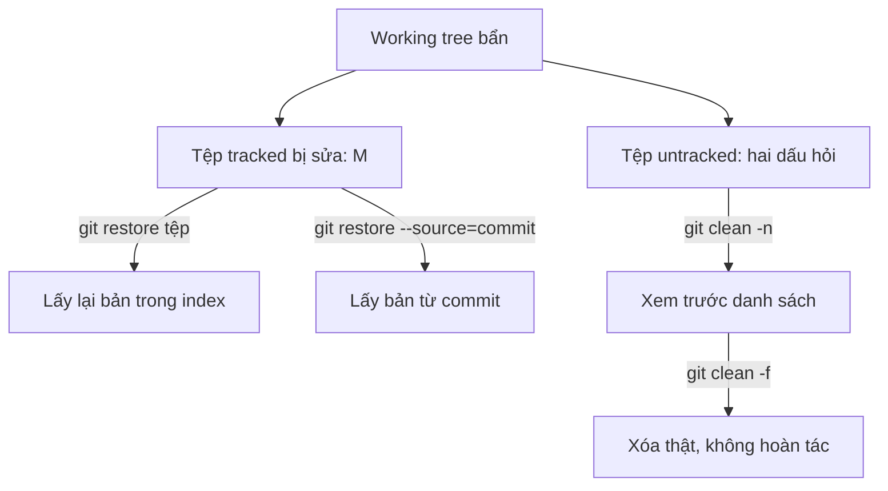

## Bạn sẽ học được gì

- Khôi phục tệp đã theo dõi về bản trong index hoặc trong một commit bằng `git restore`.
- Xóa tệp chưa được theo dõi bằng `git clean`, luôn xem trước bằng `-n`.
- Phân biệt các cờ `-d`, `-x`, `-X`, `-i` của clean.
- Hiểu vì sao hai lệnh này nguy hiểm hơn phần lớn lệnh Git khác.

## Khái niệm

Working tree "bẩn" có hai loại rác khác nhau, và mỗi loại cần một công cụ.

**Tệp đã theo dõi bị sửa** (hiện ` M` trong `git status -s`): bạn sửa thử, chạy test, giờ muốn trả về như cũ. Đây là việc của **`git restore`**. Mặc định, `git restore <tệp>` chép nội dung từ **index** ra working tree. Nếu bạn chưa stage gì, index giống HEAD, nên tệp trở về bản trong commit cuối. Thêm `--staged` thì hướng khác: chép từ HEAD vào index, tức là bỏ stage. Thêm `--source=<commit>` để lấy bản từ một commit bất kỳ. Kết hợp `--staged --worktree` để đặt cả hai vùng.

**Tệp chưa được theo dõi** (hiện `??`): log, báo cáo test, ảnh chụp màn hình, tệp tạm. Git không có bản nào của chúng để "khôi phục"; chỉ có thể **xóa**. Đây là việc của **`git clean`**. Vì lý do an toàn, Git mặc định (cấu hình `clean.requireForce=true`) từ chối chạy clean nếu bạn không truyền `-f` (force) hoặc `-n` (dry run, xem trước).

Các cờ của clean:

- `-n`: chỉ liệt kê "Would remove ...", không xóa gì. Luôn chạy trước.
- `-f`: thực sự xóa.
- `-d`: tính cả thư mục chưa theo dõi. Không có `-d`, clean chỉ xóa tệp ở các thư mục mà Git đang theo dõi.
- `-x`: xóa cả tệp bị `.gitignore` bỏ qua (ví dụ `.env` local). Rất mạnh.
- `-X`: **chỉ** xóa tệp bị bỏ qua, giữ tệp untracked khác. Hợp để dọn sản phẩm build.
- `-i`: chế độ tương tác, hỏi từng nhóm.

Điểm chung đáng sợ: cả hai lệnh đều **không có cơ chế hoàn tác**. Nội dung working tree bị `restore` ghi đè, hay tệp bị `clean` xóa, không nằm trong reflog hay trong object nào (trừ khi trước đó bạn đã add). Đó là lý do mọi lần dùng đều nên bắt đầu bằng `git status` và `git clean -n`.

`git checkout -- <tệp>` là cú pháp cũ của `git restore <tệp>`; bạn sẽ gặp nó trong tài liệu cũ.

## Hình dung bằng sơ đồ



## Lệnh cần biết

```bash
git restore <tệp>                     # working tree lấy lại bản trong index
git restore --staged <tệp>            # bỏ stage (index lấy lại bản HEAD)
git restore --staged --worktree <tệp> # cả hai vùng về HEAD
git restore --source=<commit> <tệp>   # lấy bản từ commit cụ thể
git restore .                         # mọi tệp tracked trong thư mục hiện tại
git clean -n                          # xem trước tệp untracked sẽ xóa
git clean -f                          # xóa tệp untracked
git clean -nd / -fd                   # tính cả thư mục
git clean -ndx                        # xem trước kể cả tệp bị ignore
git clean -fX                         # chỉ xóa tệp bị ignore
git clean -i                          # tương tác
```

| Cờ clean | Ý nghĩa |
| --- | --- |
| `-n` | Dry run, chỉ liệt kê |
| `-f` | Thực sự xóa |
| `-d` | Gồm thư mục untracked |
| `-x` | Gồm cả tệp bị ignore |
| `-X` | Chỉ tệp bị ignore |
| `-i` | Hỏi tương tác |

## Ví dụ từng bước

Working tree có `README.md` bị sửa sai, một tệp rác, một thư mục tạm, và `local.env` bị ignore:

```bash
git status -s
```

```text
 M README.md
?? tep-rac.txt
?? tmp/
```

Khôi phục tệp tracked:

```bash
git restore README.md
```

Xem trước rác với các mức khác nhau:

```bash
git clean -n
git clean -nd
git clean -ndx
```

```text
Would remove tep-rac.txt
Would remove tep-rac.txt
Would remove tmp/
Would remove local.env
Would remove tep-rac.txt
Would remove tmp/
```

Mức `-x` sẽ xóa cả `local.env`, có lẽ không phải điều mình muốn. Xóa tệp rác, rồi thư mục:

```bash
git clean -f
git clean -fd
git status -s --ignored
```

```text
Removing tep-rac.txt
Removing tmp/
!! local.env
```

`local.env` an toàn vì không dùng `-x`. Thử chạy clean không cờ:

```bash
git clean
```

```text
fatal: clean.requireForce is true and -f not given: refusing to clean
```

Một bẫy với restore: khi tệp đã được stage bản sai, `git restore README.md` chép từ index ra, nên tệp vẫn sai. Phải bỏ stage trước:

```bash
git restore README.md
git status -s
git restore --staged README.md
git restore README.md
git status -s
```

```text
M  README.md
```

Lần `status` cuối không in gì: sạch hẳn.

## Lỗi thường gặp

**Chạy `git clean -fdx` theo thói quen.** Bạn mất tệp `.env` local, cấu hình IDE, dữ liệu test tự tạo. Chạy `-n` trước, và chỉ thêm `-x` khi thật sự muốn.

> **Cẩn thận** Tệp bị `git clean -f` xóa không vào thùng rác và không có trong Git. Không có lệnh nào lấy lại được.

**Restore mà tệp đã stage.** Như ví dụ, kết quả không đổi. Nhớ hướng: restore mặc định lấy từ index.

**`git restore .` trong thư mục sai.** Nó tác động mọi tệp tracked dưới thư mục hiện tại. Chỉ định tệp cụ thể khi có thể.

> **Mẹo** Nếu sợ mất phần sửa, `git stash push -u` cất cả thay đổi tracked lẫn untracked; xong việc có thể `git stash drop` nếu không cần.

**Nghĩ `clean` xóa tệp tracked.** Clean chỉ đụng tệp untracked (và ignored nếu có `-x`/`-X`). Muốn bỏ sửa đổi tệp tracked, dùng restore.

## Áp dụng trong công việc

Sau một buổi chạy test end-to-end cục bộ, thư mục dự án đầy ảnh chụp màn hình, video và báo cáo HTML, đồng thời bạn lỡ sửa vài tệp fixture để thử. Bạn `git restore` các fixture, rồi `git clean -nd` để xem danh sách, xác nhận không có gì cần giữ, và `git clean -fd`. Tệp `.env.local` được giữ lại vì bạn không thêm `-x`.

## Chuẩn bị làm bài

Bài thực hành có một tệp tracked bị sửa sai và một tệp rác chưa được theo dõi. Bạn cần đưa working tree về sạch hoàn toàn. Câu hỏi hỏi lệnh xóa tệp untracked sau khi đã xem trước. Hãy:

- Chạy `git status -s` để phân loại từng tệp.
- Dùng đúng công cụ cho tệp tracked và cho tệp untracked.
- Luôn xem trước bằng chế độ dry run trước khi xóa thật.

## Tóm tắt

- `git restore` đưa tệp tracked về bản trong index, HEAD hoặc một commit.
- `git clean` xóa tệp untracked; cần `-f`, nên xem trước bằng `-n`.
- `-d` gồm thư mục, `-x` gồm tệp ignored, `-X` chỉ tệp ignored.
- Cả hai lệnh không thể hoàn tác; kiểm tra trước khi chạy.
- Tệp đã stage cần `restore --staged` trước khi restore working tree.
