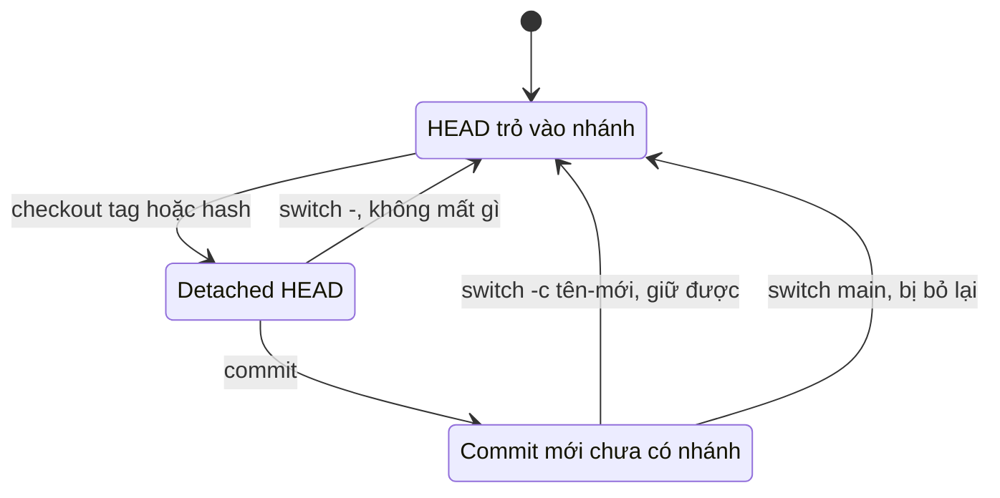
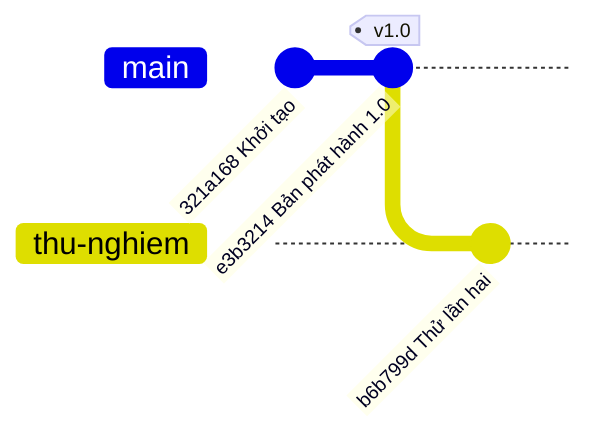

## Bạn sẽ học được gì

- Hiểu detached HEAD là gì và vì sao Git cho phép trạng thái này.
- Nhận biết khi nào mình đang ở detached HEAD.
- Giữ lại commit tạo ở detached HEAD trước và sau khi rời đi.
- Biết những tình huống thường đưa bạn vào trạng thái này.

## Khái niệm

Bình thường, HEAD trỏ tới **một nhánh**, và nhánh trỏ tới commit. Bạn có thể thấy điều này trong tệp `.git/HEAD`:

```text
ref: refs/heads/main
```

Khi bạn commit, Git tạo commit mới rồi dời **nhánh** mà HEAD đang trỏ tới. HEAD đi theo nhánh một cách gián tiếp.

**Detached HEAD** là khi HEAD trỏ **thẳng vào một commit**, không qua nhánh nào. Tệp `.git/HEAD` lúc này chỉ chứa một hash:

```text
e3b32143e032b19b517963d44bab3c864349ac78
```

Bạn rơi vào trạng thái này khi checkout một tag, một hash, hay một ref remote như `origin/main`; khi đang giữa chừng rebase; hoặc khi `git bisect` dẫn bạn qua từng commit. Đây **không phải lỗi**. Nó hữu ích khi bạn chỉ muốn xem mã ở một thời điểm, chạy lại test trên bản phát hành cũ, hay thử nhanh một ý tưởng.

Bạn vẫn commit được ở detached HEAD. Commit mới có parent là commit hiện tại, và HEAD dời sang commit mới. Vấn đề nằm ở chỗ: **không nhánh nào trỏ tới các commit đó**. Khi bạn chuyển sang nhánh khác, HEAD rời đi và không còn gì giữ chúng. Chúng trở thành commit không truy cập được, chỉ còn trong reflog `HEAD` và sẽ bị dọn khi hết hạn.

Cách cứu đơn giản: **tạo một nhánh** tại vị trí đó. Nếu bạn vẫn đang ở detached HEAD, tạo nhánh mới ngay tại HEAD và chuyển sang nó; commit đã có chỗ dựa. Nếu bạn đã rời đi, Git in sẵn hash của commit bị bỏ lại trong cảnh báo; dùng hash đó (hoặc tìm trong reflog) để tạo nhánh.

## Hình dung bằng sơ đồ





Sơ đồ thứ hai là sau khi đã gắn nhánh `thu-nghiem` cho commit tạo ở detached HEAD.

## Lệnh cần biết

```bash
git switch --detach <tag hoặc commit>   # chủ động vào detached HEAD
git status                              # dòng đầu "HEAD detached at ..."
git branch                              # dòng "* (HEAD detached at ...)"
git switch -c <tên>                     # tạo nhánh tại HEAD và chuyển sang
git branch <tên> <hash>                 # tạo nhánh cho commit đã bị bỏ lại
git switch -                            # quay lại nhánh trước đó
```

| Bạn đang ở đâu | Cách giữ commit |
| --- | --- |
| Vẫn ở detached HEAD | Tạo nhánh tại HEAD rồi chuyển sang |
| Đã chuyển sang nhánh khác | Lấy hash từ cảnh báo hoặc reflog, tạo nhánh |
| Chỉ xem, không commit | Không cần làm gì, chỉ chuyển về nhánh |

## Ví dụ từng bước

Mình muốn thử sửa lỗi trên bản 1.0. Dùng `switch` với tag mà không có `--detach` thì Git từ chối:

```text
fatal: a branch is expected, got tag 'v1.0'
hint: If you want to detach HEAD at the commit, try again with the --detach option.
```

Thêm `--detach`, rồi commit:

```bash
git switch --detach v1.0
git status
git commit -m "Thử sửa lỗi trên 1.0"
```

```text
HEAD is now at e3b3214 Bản phát hành 1.0
HEAD detached at v1.0
nothing to commit, working tree clean
[detached HEAD 579b204] Thử sửa lỗi trên 1.0
 1 file changed, 1 insertion(+)
 create mode 100644 thu.txt
```

Chú ý `[detached HEAD 579b204]` thay vì tên nhánh. Nếu giờ chuyển về `main`, Git cảnh báo:

```text
Warning: you are leaving 1 commit behind, not connected to
any of your branches:

  579b204 Thử sửa lỗi trên 1.0

If you want to keep it by creating a new branch, this may be a good time
to do so with:

 git branch <new-branch-name> 579b204

Switched to branch 'main'
```

Cảnh báo cho sẵn hash. Lần thứ hai, mình tạo nhánh **trước khi** rời đi:

```bash
git switch -c thu-nghiem
git branch --show-current
git log --oneline -2
```

```text
Switched to a new branch 'thu-nghiem'
thu-nghiem
b6b799d Thử lần hai
e3b3214 Bản phát hành 1.0
```

Khi dùng lệnh cũ `git checkout v1.0`, Git in một đoạn hướng dẫn dài bắt đầu bằng `You are in 'detached HEAD' state.` và gợi ý cùng cách `git switch -c <new-branch-name>` (output dài, mình chỉ trích dòng chính).

## Lỗi thường gặp

**Bỏ qua cảnh báo khi chuyển nhánh.** Đoạn "you are leaving 1 commit behind" chính là hash bạn cần. Chép lại ngay.

> **Cẩn thận** Đừng cố `git push` từ detached HEAD với hy vọng commit "được lưu lên server". Không có nhánh local, push mặc định dừng với `fatal: You are not currently on a branch.` Tạo nhánh trước.

**Tạo nhánh bằng `git branch <tên>` rồi quên chuyển sang.** Commit đã an toàn, nhưng HEAD vẫn detached; commit tiếp theo lại không có nhánh. `git switch -c` làm cả hai việc một lúc.

**Hoảng khi thấy detached HEAD giữa rebase hoặc bisect.** Đó là trạng thái bình thường của các thao tác này. Kết thúc chúng (`git rebase --continue`, `git bisect reset`), đừng tự tạo nhánh giữa chừng.

> **Mẹo** Prompt của shell hoặc IDE có hiện tên nhánh thì sẽ hiện hash khi detached. Bật tính năng đó để luôn biết mình đang ở đâu.

## Áp dụng trong công việc

Khách hàng báo lỗi trên bản ứng dụng ngân hàng di động đã phát hành tuần trước. Bạn checkout tag của bản đó để tái hiện lỗi, viết thêm một test chứng minh lỗi và commit. Trước khi quay về `main`, bạn tạo nhánh `test/loi-ban-1.0` tại HEAD, push lên để developer có test đó khi làm hotfix.

## Chuẩn bị làm bài

Repository bài tập đặt bạn ở detached HEAD, và commit cuối chưa thuộc nhánh nào. Bạn cần giữ commit đó bằng một nhánh có tên được yêu cầu, và cuối cùng HEAD phải đứng trên nhánh đó. Kiểm tra lại bằng `git branch --show-current` và `git log --oneline -2`, rồi xem working tree có sạch không.

## Tóm tắt

- Detached HEAD là khi HEAD trỏ thẳng vào commit, không qua nhánh.
- Thường gặp khi checkout tag, hash, ref remote, hoặc trong rebase và bisect.
- Commit ở detached HEAD sẽ bị bỏ lại nếu rời đi mà không tạo nhánh.
- Còn ở đó thì `git switch -c`; đã rời đi thì dùng hash từ cảnh báo hoặc reflog.
- Chỉ xem mã thì cứ `git switch -` để quay về.
