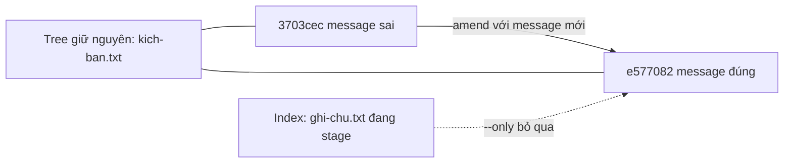
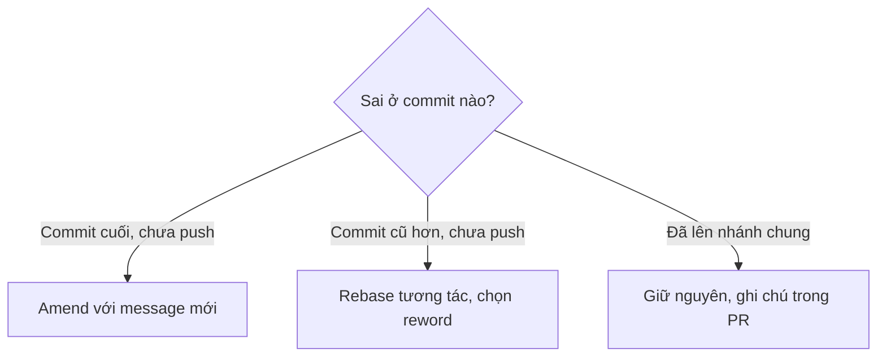

## Bạn sẽ học được gì

- Đổi subject hoặc body của commit cuối mà không thay nội dung tệp.
- Sửa message ngay trên dòng lệnh, không cần mở editor.
- Tránh vô tình kéo theo những thay đổi đang stage.
- Biết cách kiểm tra message sau khi sửa và giới hạn của thao tác này.

## Khái niệm

Lỗi message hay gặp nhất là gõ vội: thiếu dấu tiếng Việt, sai mã ticket, viết "fix" chung chung. Nếu commit đó vẫn là **commit cuối** và **chưa được chia sẻ**, bạn có thể thay message của nó.

Cơ chế giống bài trước: `git commit --amend` tạo một commit mới thay thế commit cuối, cùng parent. Điểm khác là lần này bạn chỉ quan tâm tới message, nên có hai việc cần chú ý.

Thứ nhất là **cách nhập message**. Không có tùy chọn, amend mở editor với message cũ để bạn sửa; tiện khi cần sửa body nhiều dòng. Với `-m`, bạn đưa message mới ngay trên dòng lệnh, editor không mở, và message cũ bị thay hoàn toàn. Có thể lặp `-m` để có nhiều đoạn: đoạn đầu là subject, các đoạn sau thành body, cách nhau một dòng trống.

Thứ hai là **index**. Amend luôn lấy index hiện tại làm nội dung commit mới. Nếu lúc đó bạn đã stage một tệp khác cho commit tiếp theo, tệp đó sẽ lặng lẽ chui vào commit cuối. Muốn chắc chắn chỉ đổi message, có hai cách: kiểm tra `git status` để index không có gì mới, hoặc dùng `--only` không kèm pathspec. Với `--only`, Git dựng commit từ tree của commit cuối, bỏ qua những gì đang stage; phần stage vẫn còn nguyên trong index để bạn commit sau.

Vì hash commit thay đổi, quy tắc an toàn vẫn như cũ: đã push lên nhánh chung thì đừng sửa. Message sai trên nhánh chung thường chấp nhận để nguyên; nhiều đội dùng ghi chú trong PR thay vì viết lại lịch sử.

Còn nếu message sai không nằm ở commit cuối? Amend không với tới được. Bạn cần rebase tương tác (`git rebase -i`) và đánh dấu `reword` cho commit đó, một công cụ nằm ở bài khác.

## Hình dung bằng sơ đồ





## Lệnh cần biết

```bash
git log -1 --format=%s                  # đọc subject hiện tại
git commit --amend                      # mở editor để sửa message
git commit --amend -m "<subject mới>"   # sửa ngay, không mở editor
git commit --amend -m "<subject>" -m "<body>"   # subject và body
git commit --amend --only -m "<subject>"        # bỏ qua những gì đang stage
git rev-list --count HEAD               # đếm commit để chắc số lượng không đổi
```

| Tùy chọn | Tác dụng |
| --- | --- |
| `-m` | Thay toàn bộ message, không mở editor |
| `-m` lặp lại | Mỗi lần là một đoạn |
| `--only` (không pathspec) | Giữ tree của commit cuối, không lấy index |
| `--no-edit` | Ngược lại: giữ message, chỉ đổi nội dung |

## Ví dụ từng bước

Commit cuối có subject không dấu, và mình đang stage sẵn một tệp cho việc tiếp theo:

```bash
git log --oneline
git status -s
```

```text
3703cec Them kich ban dang nhap
321a168 Khởi tạo
A  ghi-chu.txt
```

Sửa message nhưng không muốn `ghi-chu.txt` đi theo:

```bash
git commit --amend --only -m "Thêm kịch bản đăng nhập"
```

```text
[main e577082] Thêm kịch bản đăng nhập
 Date: Thu Oct 15 09:00:00 2026 +0700
 1 file changed, 1 insertion(+)
 create mode 100644 kich-ban.txt
```

Kiểm tra: tệp đang stage vẫn chờ trong index, commit chỉ chứa tệp cũ, số commit vẫn là hai:

```bash
git status -s
git log --oneline --stat -1
git rev-list --count HEAD
```

```text
A  ghi-chu.txt
e577082 Thêm kịch bản đăng nhập
 kich-ban.txt | 1 +
 1 file changed, 1 insertion(+)
2
```

Thêm body bằng hai lần `-m`:

```bash
git commit --amend --only -m "Thêm kịch bản đăng nhập" -m "Bao gồm trường hợp sai mật khẩu."
git log -1 --format=%B
```

```text
Thêm kịch bản đăng nhập

Bao gồm trường hợp sai mật khẩu.
```

## Lỗi thường gặp

**Quên giá trị sau `-m`.** Git báo ngay:

```text
error: switch `m' requires a value
```

**Không đặt message trong ngoặc kép.** Shell tách message có dấu cách thành nhiều đối số; Git hiểu các từ sau là pathspec và báo lỗi. Luôn bọc message bằng ngoặc kép.

> **Cẩn thận** Khoảng trắng ở đầu message được giữ nguyên. Thử `-m "  khoảng trắng  "` cho subject `[  khoảng trắng]` khi in bằng `--format="[%s]"`: đầu còn hai dấu cách, chỉ đuôi bị cắt. Một hệ thống so khớp subject chính xác sẽ coi đó là sai.

**Vô tình gộp tệp đang stage.** Nếu không dùng `--only`, mọi thứ trong index đi vào commit cuối. Chạy `git status` trước khi amend.

> **Mẹo** Muốn đọc nhanh message vừa sửa, `git log -1 --format=%s` chỉ in subject, tiện so với yêu cầu của ticket hay quy ước của đội.

## Áp dụng trong công việc

Quy ước của đội QA là subject bắt đầu bằng mã ticket, ví dụ `QA-310: Kiểm thử hạn mức rút tiền ATM`. Bạn commit vội mà quên mã ticket, và bot kiểm tra quy ước trên PR sẽ báo lỗi. Trước khi push, bạn sửa lại message của commit cuối bằng một lệnh, kiểm tra subject, rồi mới push lần đầu.

## Chuẩn bị làm bài

Repository bài tập có commit cuối với subject gõ sai, và đề bài cho subject đúng. Bạn cần đổi message mà không tạo commit mới và không mở editor. Hãy gõ chính xác subject yêu cầu, kể cả dấu tiếng Việt, rồi kiểm tra subject và số commit sau khi sửa, và chắc chắn working tree sạch.

## Tóm tắt

- Amend thay commit cuối bằng commit mới; dùng để sửa message khi chưa chia sẻ.
- `-m` thay message không qua editor; lặp `-m` để có body.
- `--only` không pathspec giữ nội dung commit, bỏ qua phần đang stage.
- Bọc message trong ngoặc kép và kiểm tra lại bằng `git log -1 --format=%s`.
- Commit cũ hơn cần rebase tương tác với `reword`.
