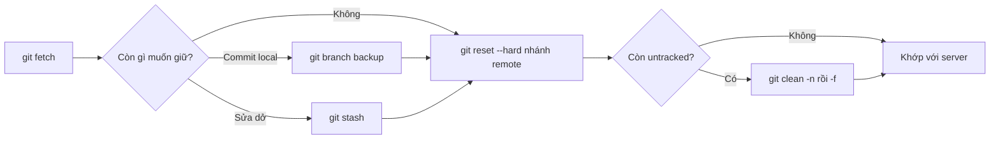
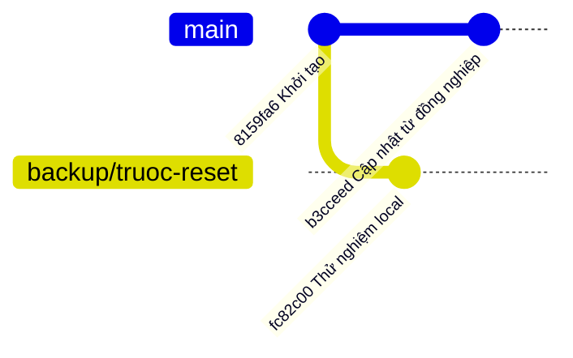

## Bạn sẽ học được gì

- Đưa nhánh local về đúng trạng thái của nhánh trên remote, bỏ hết thay đổi local.
- Hiểu vì sao phải fetch trước, và mốc đích thật sự là gì.
- Biết chính xác những gì bị mất, những gì còn lại sau thao tác.
- Tạo lưới an toàn trước khi chạy một lệnh không thể hoàn tác hoàn toàn.

## Khái niệm

Đôi khi nhánh local của bạn đã rối tới mức sửa không bõ: thử nghiệm lung tung, commit nhầm, merge sai. Điều bạn muốn là: "cho nhánh của mình **giống hệt** nhánh trên server, như vừa clone xong". Đó là việc của `git reset --hard` với mốc đích là nhánh remote-tracking tương ứng.

Nhớ lại ba trees: `reset --hard <mốc>` dời nhánh hiện tại sang `<mốc>`, ghi đè index và working tree theo commit đó. Khi mốc là nhánh remote-tracking (ví dụ `origin/main`), kết quả là nhánh local trùng khớp với bản mà Git biết về server.

Chú ý cụm "bản mà Git biết". Nhánh remote-tracking là **bản chụp local** của nhánh trên server, chỉ được cập nhật khi bạn `git fetch` (hoặc `pull`). Nếu bạn không fetch, mốc đích có thể đã cũ nhiều ngày. Vì vậy thao tác chuẩn luôn có hai bước: **fetch**, rồi **reset**.

Những gì **mất** sau lệnh này:

- Commit local chưa push: không còn trên nhánh (vẫn trong reflog một thời gian).
- Sửa đổi chưa commit của tệp tracked, cả staged lẫn unstaged: mất hẳn, không có trong reflog.

Những gì **còn lại**:

- Tệp untracked: `reset` không đụng tới. Muốn working tree sạch hoàn toàn, cần thêm `git clean`.
- Các nhánh khác, stash, tag: không bị ảnh hưởng.

Vì phần sửa đổi chưa commit không thể cứu, đây là lệnh nên chạy **có lưới an toàn**: tạo một nhánh backup tại vị trí hiện tại để giữ commit local, và stash (hoặc commit tạm) những sửa đổi còn muốn giữ.

Lệnh này an toàn cho remote: nó chỉ thay đổi repository local của bạn. Nó **khác hẳn** việc force push, thứ ghi đè nhánh trên server.

## Hình dung bằng sơ đồ





Sau khi reset, `main` đứng ở `b3cceed` cùng với `origin/main`; commit thử nghiệm vẫn được giữ trên nhánh backup.

## Lệnh cần biết

```bash
git fetch                          # cập nhật nhánh remote-tracking
git status -sb                     # xem ahead/behind so với upstream
git log --oneline <remote>/<nhánh>..<nhánh>   # commit local sẽ bị bỏ
git diff --stat                    # sửa đổi chưa commit sẽ bị mất
git branch backup/<tên>            # lưới an toàn cho commit local
git reset --hard <remote>/<nhánh>  # khớp nhánh local với bản remote
git reset --hard @{u}              # cùng ý nghĩa, dùng upstream đã cấu hình
git clean -n                       # xem tệp untracked còn lại
```

| Thành phần | Sau reset --hard về remote |
| --- | --- |
| Commit local chưa push | Rời khỏi nhánh, còn trong reflog |
| Sửa đổi tracked chưa commit | Mất hẳn |
| Tệp untracked | Còn nguyên |
| Nhánh trên server | Không đổi |

## Ví dụ từng bước

Nhánh local đang có một commit thử nghiệm, README đang sửa dở, và một tệp rác:

```bash
git fetch
git status -sb
git log --oneline origin/main..main
git diff --stat
```

```text
## main...origin/main [ahead 1]
 M README.md
?? rac.txt
fc82c00 Thử nghiệm local
 README.md | 1 +
 1 file changed, 1 insertion(+)
```

Mình đã biết chính xác sẽ bỏ một commit và một sửa đổi. Tạo backup cho commit, rồi reset:

```bash
git branch backup/truoc-reset
git reset --hard origin/main
git status -sb
```

```text
HEAD is now at 8159fa6 Khởi tạo
## main...origin/main
?? rac.txt
```

Nhánh đã khớp với remote, nhưng `rac.txt` vẫn còn. Commit thử nghiệm vẫn có trên nhánh backup:

```bash
git clean -n
git log --oneline -1 backup/truoc-reset
```

```text
Would remove rac.txt
fc82c00 Thử nghiệm local
```

Vì sao fetch quan trọng: sau đó, đồng nghiệp push một commit mới. Trước khi fetch, `status` vẫn báo khớp. Sau khi fetch thì khác:

```bash
git fetch
git status -sb
git reset --hard origin/main
```

```text
From /tmp/gt/u12b/o
   8159fa6..b3cceed  main       -> origin/main
## main...origin/main [behind 1]
?? rac.txt
HEAD is now at b3cceed Cập nhật từ đồng nghiệp
```

## Lỗi thường gặp

**Quên fetch.** Reset về một bản chụp cũ; bạn nghĩ đã khớp với server nhưng thật ra vẫn thiếu commit mới.

> **Cẩn thận** Sửa đổi chưa commit bị `reset --hard` xóa thì không cứu được bằng reflog. Luôn xem `git diff --stat` và `git status` trước, stash những gì còn muốn giữ.

**Reset về sai nhánh remote.** Đang ở nhánh `test/abc` mà reset về `origin/main` sẽ biến nhánh test thành bản sao của `main`. Kiểm tra `git branch --show-current`, hoặc dùng `@{u}` để Git tự lấy upstream của nhánh hiện tại.

**Tưởng working tree đã sạch.** Tệp untracked còn lại có thể làm test chạy khác với máy CI. Dùng `git clean -n` để xem, rồi `-f` khi chắc chắn.

> **Lưu ý** Commit local bị bỏ vẫn có thể cứu bằng reflog, như bài trước. Tạo nhánh backup trước chỉ là cách nhanh và chắc chắn hơn.

## Áp dụng trong công việc

Máy test dùng chung của nhóm QA có một clone của repository kịch bản kiểm thử ngân hàng số. Ai đó đã sửa tạm vài tệp và commit thử trực tiếp trên `main` của máy đó, làm kết quả chạy đêm sai lệch. Bạn fetch, xem những gì sẽ bị bỏ, tạo nhánh backup cho chắc, rồi đồng bộ cứng và dọn tệp rác, để máy test chạy đúng phiên bản trên server.

## Chuẩn bị làm bài

Repository bài tập là một sandbox: `main` có commit local và sửa đổi chưa commit mà đề bài cho phép bỏ. Bạn cần đưa HEAD về đúng commit của nhánh tương ứng trên remote và để working tree sạch. Hãy tự xác định mốc đích phù hợp từ `git status -sb` và `git branch -vv`, rồi so `git rev-parse HEAD` với hash của mốc đó.

## Tóm tắt

- `reset --hard` về nhánh remote-tracking làm nhánh local khớp với bản Git biết về server.
- Luôn fetch trước, vì nhánh remote-tracking chỉ cập nhật khi fetch.
- Commit local còn trong reflog; sửa đổi tracked chưa commit thì mất hẳn.
- Tệp untracked còn lại; dọn bằng `git clean`.
- Tạo nhánh backup và stash trước khi chạy để có lưới an toàn.
