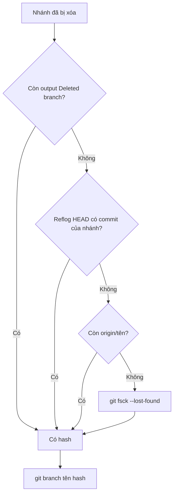
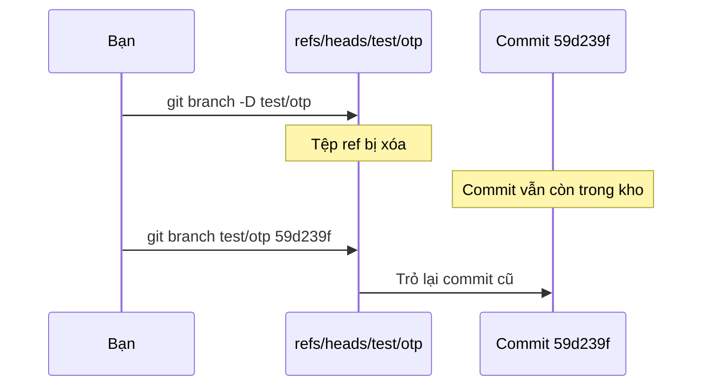

## Bạn sẽ học được gì

- Hiểu xóa nhánh thực ra xóa gì và giữ lại gì.
- Tìm object ID của đầu nhánh đã xóa từ ba nguồn khác nhau.
- Tạo lại tên nhánh tại đúng commit đó mà không đụng nhánh đang đứng.
- Phân biệt `git branch -d` và `-D` để tránh xóa nhầm ngay từ đầu.

## Khái niệm

Nhánh trong Git chỉ là một **tệp nhỏ chứa một hash**, nằm ở `refs/heads/<tên>`. Xóa nhánh là xóa tệp đó (và reflog riêng của nhánh). Các commit **không bị xóa ngay**. Nếu chúng đã được merge vào nhánh khác thì vẫn reachable như thường. Nếu chưa, chúng thành commit không truy cập được, nằm chờ cho tới khi `git gc` dọn sau thời hạn của reflog.

Vì vậy khôi phục nhánh luôn là: **tìm hash của đầu nhánh cũ**, rồi **tạo lại tên nhánh** tại hash đó. Không có lệnh "undelete"; tạo lại ref là đủ, vì commit chưa bao giờ mất.

Có ba nguồn để tìm hash:

1. **Thông báo lúc xóa**. `git branch -D` in `Deleted branch <tên> (was <hash>)`. Nếu terminal còn, đó là cách nhanh nhất.
2. **Reflog của HEAD**. Reflog của chính nhánh đã bị xóa cùng nhánh, nên `git reflog show <tên>` báo lỗi. Nhưng nếu bạn từng đứng trên nhánh đó, reflog của HEAD vẫn có các dòng "commit: ..." và "checkout: moving from <tên> to ...". Dòng commit cuối trước khi rời nhánh chính là đầu nhánh.
3. **Remote**. Nếu nhánh đã từng được push, `origin/<tên>` (chưa bị prune) vẫn trỏ tới bản trên server; tạo lại nhánh local từ đó.

Khi đã có hash, `git branch <tên> <hash>` tạo lại nhánh **mà không chuyển sang**: bạn vẫn đứng nguyên ở nhánh hiện tại, working tree không đổi.

Còn để phòng ngừa: `git branch -d` chỉ xóa khi nhánh đã được merge (vào upstream của nó, hoặc vào HEAD nếu không có upstream), nếu không thì từ chối. `-D` (tức `--delete --force`) xóa bất kể. Hãy để `-d` làm lớp bảo vệ; chỉ dùng `-D` khi bạn chắc chắn bỏ phần chưa merge.

## Hình dung bằng sơ đồ





## Lệnh cần biết

```bash
git branch -d <tên>                 # xóa an toàn, từ chối nếu chưa merge
git branch -D <tên>                 # xóa cưỡng bức, in hash cũ
git reflog                          # reflog HEAD, tìm commit cuối trên nhánh
git log -g --all --format="%h %gd %s"   # đọc reflog của mọi ref còn tồn tại
git branch <tên> <hash>             # tạo lại nhánh, không chuyển sang
git branch <tên> origin/<tên>       # tạo lại từ bản trên remote
```

| Nguồn | Có khi nào | Mất khi nào |
| --- | --- | --- |
| `Deleted branch ... (was ...)` | Ngay lúc xóa | Đóng terminal |
| Reflog HEAD | Bạn từng đứng trên nhánh | Hết hạn reflog |
| `origin/<tên>` | Nhánh đã push | Bị prune hoặc xóa trên server |

## Ví dụ từng bước

Mình có nhánh `test/otp` với một commit chưa merge. Thử xóa an toàn trước:

```bash
git branch -d test/otp
```

```text
error: the branch 'test/otp' is not fully merged
hint: If you are sure you want to delete it, run 'git branch -D test/otp'
hint: Disable this message with "git config advice.forceDeleteBranch false"
```

Git đã cảnh báo, nhưng mình vẫn dùng `-D`:

```bash
git branch -D test/otp
git reflog show test/otp
```

```text
Deleted branch test/otp (was 59d239f).
fatal: ambiguous argument 'test/otp': unknown revision or path not in the working tree.
Use '--' to separate paths from revisions, like this:
'git <command> [<revision>...] -- [<file>...]'
```

Reflog riêng của nhánh đã mất. Reflog HEAD thì còn:

```bash
git reflog
```

```text
321a168 HEAD@{0}: checkout: moving from test/otp to main
59d239f HEAD@{1}: commit: Test OTP
321a168 HEAD@{2}: checkout: moving from main to test/otp
321a168 HEAD@{3}: commit (initial): Khởi tạo
```

Đọc từ dưới lên: chuyển sang `test/otp`, commit "Test OTP", rồi rời về `main`. Đầu nhánh là `59d239f`, khớp với thông báo lúc xóa. Tạo lại:

```bash
git branch test/otp 59d239f
git log --oneline test/otp
git branch
```

```text
59d239f Test OTP
321a168 Khởi tạo
* main
  test/otp
```

Nhánh đã trở lại, còn mình vẫn ở `main`.

## Lỗi thường gặp

**Tìm trong reflog của nhánh đã xóa.** Reflog đó bị xóa cùng nhánh. Tìm trong reflog HEAD.

**Chọn nhầm dòng reflog.** Nếu bạn commit nhiều lần trên nhánh, hãy lấy dòng commit **gần nhất** trước dòng "checkout: moving from <tên>". Lấy dòng cũ hơn sẽ mất các commit sau.

> **Lưu ý** `git log -g --all` chỉ đọc reflog của các ref còn tồn tại. Nhánh đã xóa không còn reflog riêng, nhưng dấu vết của nó vẫn xuất hiện qua các dòng `HEAD@{n}`.

**Dùng `git switch -c` hay `git reset` để khôi phục.** `switch -c <tên> <hash>` cũng tạo lại nhánh nhưng đồng thời chuyển bạn sang đó; `reset` thì dời nhánh hiện tại. Nếu đề bài yêu cầu ở lại nhánh hiện tại, dùng `git branch`.

> **Mẹo** Thói quen tốt: luôn thử `-d` trước. Nếu Git từ chối, dừng lại xem `git log main..<tên>` để biết chính xác mình sắp bỏ những commit nào.

## Áp dụng trong công việc

Dọn nhánh cuối sprint, bạn xóa hàng loạt nhánh test bằng `-D` và lỡ tay xóa luôn `test/sao-ke-thang` chứa bộ kiểm thử sao kê tài khoản chưa merge. Bạn tìm trong reflog HEAD dòng commit cuối trên nhánh đó, tạo lại nhánh tại hash vừa tìm, rồi mở PR ngay để nó không còn chỉ nằm trên máy mình.

## Chuẩn bị làm bài

Repository bài tập đã có một nhánh bị xóa, commit của nó chưa merge vào `main`. Bạn cần tìm hash của commit đó trong lịch sử di chuyển, tạo lại nhánh với đúng tên cũ, và vẫn đứng ở `main` khi kết thúc. Kiểm tra bằng `git log --oneline <tên>` và `git branch --show-current`.

## Tóm tắt

- Xóa nhánh chỉ xóa ref và reflog của nó; commit vẫn còn một thời gian.
- Hash đầu nhánh có thể lấy từ thông báo lúc xóa, reflog HEAD, hoặc `origin/<tên>`.
- `git branch <tên> <hash>` tạo lại nhánh mà không chuyển sang.
- `-d` từ chối xóa nhánh chưa merge; `-D` xóa bất kể.
- Khôi phục sớm, trước khi reflog hết hạn và `gc` dọn commit.
