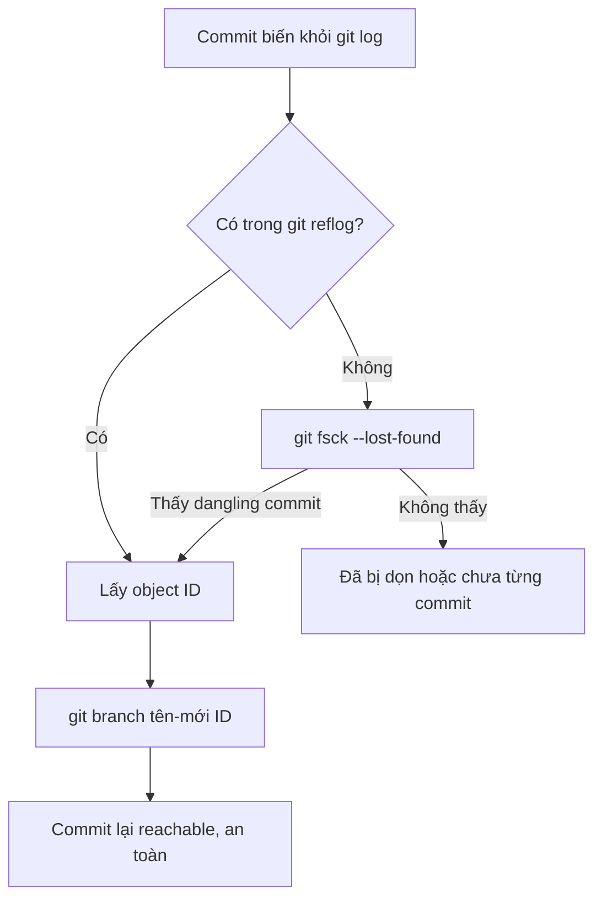
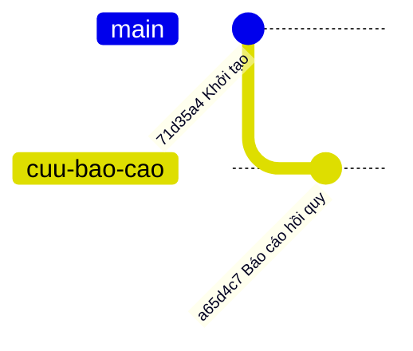

## Bạn sẽ học được gì

- Hiểu vì sao commit "biến mất" sau reset nhưng chưa bị xóa thật.
- Tìm object ID của commit thất lạc bằng reflog và `git fsck`.
- Gắn lại commit đó vào một nhánh để giữ an toàn.
- Biết khi nào commit thật sự không còn cứu được.

## Khái niệm

Một commit "tồn tại" trong Git theo hai nghĩa khác nhau:

- **Object tồn tại**: dữ liệu commit còn nằm trong `.git/objects`.
- **Commit có thể truy cập (reachable)**: đi từ một ref nào đó (nhánh, tag, HEAD, stash) theo chuỗi parent sẽ tới được nó.

`git log`, `git log --all` và hầu hết công cụ chỉ cho bạn thấy commit reachable. Khi bạn `git reset --hard HEAD~1`, nhánh lùi một bước; commit cuối không còn ref nào trỏ tới, nên nó biến khỏi mọi log. Nhưng **object vẫn còn đó**. Git chỉ xóa object không truy cập được khi chạy dọn rác (`git gc`, đôi khi tự chạy ngầm), và kể cả khi đó, object còn được reflog nhắc tới sẽ được giữ cho tới khi mục reflog hết hạn.

Vậy quy trình cứu luôn gồm hai bước:

1. **Tìm object ID** của commit thất lạc.
2. **Gắn một ref** vào nó, thường là một nhánh mới, để nó trở lại thành reachable và không bị dọn.

Nguồn thứ nhất để tìm là **reflog**: mỗi lần HEAD đổi vị trí đều được ghi, nên commit bạn đã từng đứng trên sẽ có ở đó, kèm subject. Đây là cách nhanh và phổ biến nhất.

Nguồn thứ hai là **`git fsck`**, dùng khi reflog không giúp được (ví dụ commit chưa bao giờ được HEAD trỏ tới, như một stash đã drop, hoặc reflog đã bị xóa). `git fsck --lost-found` bỏ qua reflog, liệt kê các commit "dangling" (không có ref hay commit nào trỏ tới) và chép ID của chúng vào `.git/lost-found/`. `git fsck --unreachable --no-reflogs` liệt kê mọi object không truy cập được, kể cả tree và blob.

Commit không cứu được khi: object đã bị `gc` dọn sau khi hết hạn, hoặc nó chưa bao giờ được tạo (sửa đổi chưa commit bị `reset --hard` xóa). Trường hợp thứ hai rất hay bị nhầm.

## Hình dung bằng sơ đồ





Sơ đồ thứ hai là trạng thái sau khi cứu: `main` vẫn ở chỗ đã reset, còn commit thất lạc có nhánh riêng giữ lại.

## Lệnh cần biết

```bash
git reflog                           # tìm vị trí HEAD từng đứng
git log -g --format="%h %gd %s"      # reflog kèm subject, tiện tìm theo tên
git show --stat <id>                 # kiểm tra đúng commit chưa
git fsck --lost-found                # tìm commit dangling, bỏ qua reflog
git fsck --unreachable --no-reflogs  # mọi object không truy cập được
git branch <tên> <id>                # gắn nhánh vào commit tìm được
git cherry-pick <id>                 # hoặc chép thay đổi đó sang nhánh hiện tại
```

| Công cụ | Thấy gì | Khi nào dùng |
| --- | --- | --- |
| `git reflog` | Vị trí HEAD/nhánh từng đi qua | Hầu hết trường hợp |
| `git fsck --lost-found` | Commit dangling | Reflog không có, ví dụ stash đã drop |
| `git log --all` | Chỉ commit reachable | Không giúp tìm commit thất lạc |

## Ví dụ từng bước

Mình có commit "Báo cáo hồi quy" rồi reset nhầm:

```bash
git reset --hard HEAD~1
git log --oneline --all
```

```text
HEAD is now at 71d35a4 Khởi tạo
71d35a4 Khởi tạo
```

Ngay cả `--all` cũng không thấy. Reflog thì có:

```bash
git reflog
```

```text
71d35a4 HEAD@{0}: reset: moving to HEAD~1
a65d4c7 HEAD@{1}: commit: Báo cáo hồi quy
71d35a4 HEAD@{2}: commit (initial): Khởi tạo
```

Cách thứ hai, không dựa vào reflog:

```bash
git fsck --lost-found
git fsck --unreachable --no-reflogs
```

```text
dangling commit a65d4c75c8d6cfde2e5f416a0ef76aef0d4ffef0
unreachable commit a65d4c75c8d6cfde2e5f416a0ef76aef0d4ffef0
unreachable tree f5257b7e0b2c1f1c9af48cb026d8e29fba9da7b5
unreachable blob 38da85c80fd745cda3be0bfda3ba8f5a17a56cfe
```

Lưu ý `git fsck` không có tùy chọn sẽ không in gì ở đây, vì nó coi các mục reflog là còn được tham chiếu.

Kiểm tra trước khi cứu, rồi gắn nhánh:

```bash
git show --stat --format=%s a65d4c7
git branch cuu-bao-cao a65d4c7
git log --oneline cuu-bao-cao
git branch --show-current
```

```text
Báo cáo hồi quy

 bao-cao.txt | 1 +
 1 file changed, 1 insertion(+)
a65d4c7 Báo cáo hồi quy
71d35a4 Khởi tạo
main
```

Bạn vẫn đứng ở `main`; commit đã an toàn trên `cuu-bao-cao`. Sau đó bạn tự chọn merge, cherry-pick hay chỉ giữ để tham khảo.

## Lỗi thường gặp

**Tìm bằng `git log --all`.** Lệnh này chỉ đi từ các ref hiện có, nên không bao giờ thấy commit thất lạc.

**Cứu bằng cách reset nhánh hiện tại.** `git reset --hard <id>` có thể cứu được, nhưng cũng có thể xóa thêm công việc đang làm. Tạo nhánh mới an toàn hơn và không đụng tới working tree.

> **Lưu ý** Ngay khi phát hiện mất commit, đừng chạy `git gc` hay `git prune`. Gắn nhánh trước, phân tích sau.

**Mong cứu được sửa đổi chưa commit.** Reflog và fsck chỉ làm việc với object đã được tạo. Ngoại lệ hiếm: tệp bạn đã `git add` có blob trong kho, và `git fsck --lost-found` có thể tìm thấy blob đó trong `.git/lost-found/other/`.

> **Mẹo** Khi reflog dài, dùng `git log -g --format="%h %gd %s"` rồi tìm theo subject commit; nhanh hơn đọc từng dòng.

## Áp dụng trong công việc

Cuối ngày, bạn reset nhánh test thanh toán thẻ về `origin` để làm lại cho sạch, rồi nhớ ra commit cuối có bộ kịch bản kiểm thử hoàn tiền chưa push. Không cần hoảng: tìm subject trong reflog, gắn nhánh `cuu/hoan-tien` vào đó, rồi cherry-pick commit vào nhánh mới. Toàn bộ chỉ mất một phút nếu bạn làm ngay.

## Chuẩn bị làm bài

Repository bài tập đã bị reset, làm mất một commit có subject đặc trưng. Bạn cần tìm object ID của commit đó và tạo một nhánh với tên được yêu cầu trỏ vào nó, trong khi vẫn đứng ở `main`. Sau khi làm, hãy xác nhận bằng `git show` rằng tệp của commit đó có mặt trên nhánh mới.

## Tóm tắt

- Reset làm commit mất khỏi log, nhưng object vẫn còn cho tới khi bị dọn.
- Tìm ID bằng reflog trước, `git fsck --lost-found` khi reflog không giúp được.
- Gắn nhánh mới vào ID để giữ commit an toàn, không đụng working tree.
- Sửa đổi chưa từng commit thì gần như không cứu được.
- Cứu ngay, đừng chạy `gc` trước khi gắn ref.
