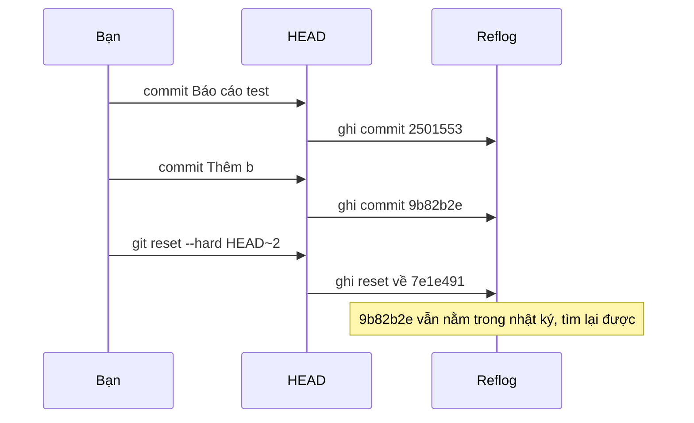
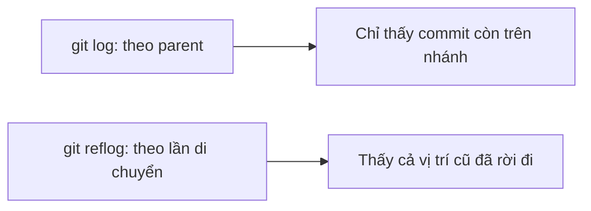

## Bạn sẽ học được gì

- Hiểu reflog ghi lại điều gì và nó khác `git log` ở chỗ nào.
- Đọc một dòng reflog và dùng cú pháp `HEAD@{n}`, `main@{n}`.
- Dùng reflog để tìm lại vị trí cũ sau reset, rebase, amend hay chuyển nhánh.
- Biết giới hạn: reflog chỉ ở local và có thời hạn.

## Khái niệm

`git log` kể lịch sử **của commit**: commit này có cha là commit kia. Nhưng nó không kể **bạn đã làm gì** với repository. Nếu bạn reset nhánh lùi ba commit, `git log` chỉ còn thấy lịch sử ngắn hơn, như thể ba commit kia chưa từng tồn tại.

**Reflog** (reference log) lấp khoảng trống đó. Mỗi khi HEAD hoặc một nhánh **đổi vị trí** (commit mới, checkout, reset, merge, rebase, amend, cherry-pick, pull...), Git ghi một dòng vào nhật ký: vị trí mới là commit nào, và lý do. Mỗi ref có nhật ký riêng: `HEAD` có một, `main` có một, mỗi nhánh có một. Các tệp nằm trong `.git/logs/`.

Một dòng reflog như:

```text
9b82b2e HEAD@{3}: commit: Thêm b
```

đọc là: "ba lần di chuyển trước, HEAD ở commit `9b82b2e`, và lý do di chuyển tới đó là một commit với subject Thêm b". `HEAD@{0}` là hiện tại, `HEAD@{1}` là vị trí ngay trước, và cứ thế. Bạn dùng cú pháp này ở mọi chỗ cần một commit: `git show HEAD@{2}`, `git branch cuu HEAD@{1}`, `git reset --hard main@{1}`. Có cả dạng thời gian như `main@{yesterday}` hay `HEAD@{2.hours.ago}`.

Khác biệt giữa reflog của `HEAD` và của một nhánh: reflog `HEAD` ghi **mọi** lần HEAD di chuyển, kể cả chuyển nhánh; reflog `main` chỉ ghi khi chính `main` đổi vị trí. Khi tìm "vị trí trước khi mình làm hỏng nhánh", reflog của nhánh thường gọn hơn.

Giới hạn cần nhớ:

- Reflog là **local**: không được push, không có trong bản clone. Máy của đồng nghiệp có reflog riêng.
- Có **thời hạn**: mặc định mục còn truy cập được giữ khoảng 90 ngày, mục không còn truy cập được khoảng 30 ngày, sau đó `git gc` có thể dọn.
- Reflog chỉ ghi **vị trí ref**, không ghi sửa đổi chưa commit. Thay đổi bị `reset --hard` xóa khỏi working tree không có trong reflog.
- Xóa nhánh thì reflog của nhánh đó cũng bị xóa; nhưng reflog `HEAD` vẫn còn dấu vết nếu bạn từng đứng trên nhánh.

## Hình dung bằng sơ đồ





## Lệnh cần biết

```bash
git reflog                      # reflog của HEAD (= git reflog show HEAD)
git reflog show <nhánh>         # reflog của một nhánh
git reflog --date=iso           # hiện thời gian thay vì số thứ tự
git log -g --oneline            # đọc reflog bằng định dạng của log
git reflog --format="%h %gd %gs | %s"   # tùy biến: hash, chỉ mục, lý do, subject
git show HEAD@{1}               # xem commit ở vị trí trước
git branch <tên> HEAD@{n}       # gắn tên nhánh vào vị trí cũ
git reset --hard <nhánh>@{1}    # đưa nhánh về vị trí ngay trước
```

| Cú pháp | Ý nghĩa |
| --- | --- |
| `HEAD@{0}` | Vị trí hiện tại của HEAD |
| `HEAD@{1}` | Vị trí ngay trước của HEAD |
| `main@{2}` | Vị trí thứ hai trước đây của nhánh main |
| `main@{yesterday}` | Nơi main ở vào hôm qua |

## Ví dụ từng bước

Mình tạo hai commit, chuyển qua lại một nhánh, rồi reset `main` lùi hai commit. `git log` chỉ còn:

```bash
git log --oneline
```

```text
7e1e491 Khởi tạo
```

Reflog thì nhớ hết:

```bash
git reflog
```

```text
7e1e491 HEAD@{0}: reset: moving to HEAD~2
9b82b2e HEAD@{1}: checkout: moving from feature to main
9b82b2e HEAD@{2}: checkout: moving from main to feature
9b82b2e HEAD@{3}: commit: Thêm b
2501553 HEAD@{4}: commit: Báo cáo test
7e1e491 HEAD@{5}: commit (initial): Khởi tạo
```

Reflog riêng của `main` gọn hơn vì không có các lần chuyển nhánh:

```bash
git reflog show main
```

```text
7e1e491 main@{0}: reset: moving to HEAD~2
9b82b2e main@{1}: commit: Thêm b
2501553 main@{2}: commit: Báo cáo test
7e1e491 main@{3}: commit (initial): Khởi tạo
```

Xem nhanh vị trí trước khi reset, và kèm thời gian:

```bash
git show --stat HEAD@{1}
git reflog --date=iso -1
```

```text
commit 9b82b2e90e0aec2076c4cbac4f5693377b300a2e
Author: Duy Van <duy@example.invalid>
Date:   Thu Oct 15 09:00:00 2026 +0700

    Thêm b

 b.txt | 1 +
 1 file changed, 1 insertion(+)
7e1e491 HEAD@{2026-10-15 10:20:00 +0700}: reset: moving to HEAD~2
```

Gắn tên vào vị trí cũ để giữ lại:

```bash
git branch recovered HEAD@{1}
git log --oneline recovered
```

```text
9b82b2e Thêm b
2501553 Báo cáo test
7e1e491 Khởi tạo
```

## Lỗi thường gặp

**Dùng chỉ số reflog sau khi đã làm thêm thao tác.** `HEAD@{1}` thay đổi ý nghĩa sau mỗi lần HEAD di chuyển. Đọc lại reflog ngay trước khi dùng, hoặc dùng hash.

> **Lưu ý** Trong một số shell (như PowerShell), dấu ngoặc nhọn có nghĩa đặc biệt. Đặt `"HEAD@{1}"` trong ngoặc kép cho chắc.

**Tìm commit của đồng nghiệp trong reflog của mình.** Reflog chỉ ghi những gì xảy ra trên máy bạn. Hỏi họ, hoặc tìm trên remote.

**Chờ quá lâu.** Sau khi hết hạn và `gc` chạy, commit không còn được tham chiếu có thể bị dọn. Cứu ngay khi phát hiện.

> **Mẹo** `git reflog --format="%h %gd %gs | %s"` thêm subject của commit vào mỗi dòng, giúp tìm theo thông điệp dễ hơn khi reflog dài.

**Nghĩ reflog cứu được mọi thứ.** Sửa đổi chưa commit bị ghi đè không bao giờ vào reflog. Commit thường xuyên, hoặc stash, trước thao tác rủi ro.

## Áp dụng trong công việc

Bạn rebase nhánh test lên `main` mới, giải quyết conflict hơi vội, và sau đó bộ test hỏng lung tung. Thay vì sửa tiếp trên kết quả rebase, bạn mở `git reflog show test/QA-77`, thấy dòng ngay trước "rebase (start)", và đặt nhánh về đó bằng `git reset --hard test/QA-77@{1}`. Bạn rebase lại cẩn thận hơn, lần này đọc kỹ từng conflict.

## Chuẩn bị làm bài

Đây là bài câu hỏi: bạn cần nêu lệnh xem lịch sử di chuyển của HEAD. Trong repository bài tập, hãy thử tạo vài commit, chuyển nhánh, reset lùi một bước, rồi so sánh output của `git log` với lệnh trong bài để thấy sự khác biệt. Thử thêm `git show HEAD@{1}`.

## Tóm tắt

- Reflog ghi mỗi lần HEAD hoặc một nhánh đổi vị trí, kèm lý do.
- `HEAD@{n}` và `<nhánh>@{n}` chỉ tới vị trí cũ; dùng được ở mọi lệnh.
- Reflog giúp tìm lại commit sau reset, rebase, amend.
- Reflog là local, có thời hạn, và không ghi sửa đổi chưa commit.
- Đọc lại reflog ngay trước khi dùng chỉ số.
