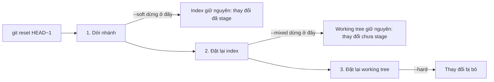

## Bạn sẽ học được gì

- Hiểu ba chế độ `--soft`, `--mixed`, `--hard` qua mô hình ba vùng.
- Chọn đúng chế độ cho từng tình huống: gộp lại commit, bỏ stage, bỏ hẳn thay đổi.
- Dùng `ORIG_HEAD` và reflog để quay lại sau một lần reset.
- Phân biệt reset cả nhánh với reset một tệp.

## Khái niệm

Bài trước nói `git reset <commit>` dời nhánh. Chính xác hơn, reset làm tối đa ba bước, và chế độ quyết định nó dừng ở bước nào:

1. **Dời nhánh** (qua HEAD) tới commit đích.
2. **Làm index giống** commit đích.
3. **Làm working tree giống** commit đích.

| Chế độ | Bước 1: nhánh | Bước 2: index | Bước 3: working tree |
| --- | --- | --- | --- |
| `--soft` | Có | Không | Không |
| `--mixed` (mặc định) | Có | Có | Không |
| `--hard` | Có | Có | Có |

Đọc theo mô hình ba vùng ở track nền tảng:

**`--soft`**: chỉ HEAD lùi lại. Index vẫn chứa nội dung của commit vừa bỏ, nên mọi thay đổi của commit đó hiện ra như "đã stage, sẵn sàng commit". Dùng khi muốn **làm lại commit**: viết lại thông điệp, gộp vài commit cuối thành một, hay thêm tệp trước khi commit lại.

**`--mixed`**: HEAD lùi và index được đặt lại theo commit đích. Thay đổi của commit bị bỏ vẫn nằm trong working tree nhưng **chưa stage**. Dùng khi muốn chia lại commit theo cách khác: stage từng phần rồi commit lại.

**`--hard`**: cả ba vùng trùng với commit đích. Thay đổi của commit bị bỏ **và** mọi sửa đổi chưa commit của bạn trên các tệp được theo dõi đều biến mất khỏi working tree. Dùng khi chắc chắn muốn vứt bỏ.

Sau mỗi lần reset dời nhánh, Git lưu vị trí cũ vào `ORIG_HEAD`, và reflog cũng ghi lại. Vì vậy commit bị "bỏ" vẫn cứu được. Nhưng sửa đổi chưa commit bị `--hard` xóa thì **không** nằm ở đâu cả.

Có một dạng khác: `git reset <tệp>` (không có chế độ, kèm đường dẫn) chỉ làm bước 2 cho tệp đó, tức là bỏ stage tệp. Nó tương đương `git restore --staged <tệp>`. Ngoài ra `--keep` giống `--hard` nhưng từ chối nếu có sửa đổi local sẽ bị mất, một lựa chọn an toàn hơn.

## Hình dung bằng sơ đồ



## Lệnh cần biết

```bash
git reset --soft HEAD~1     # bỏ commit cuối, giữ thay đổi đã stage
git reset HEAD~1            # (--mixed) bỏ commit cuối, giữ thay đổi chưa stage
git reset --hard HEAD~1     # bỏ commit cuối và mọi thay đổi
git reset --keep HEAD~1     # như hard nhưng từ chối nếu mất sửa đổi local
git reset --hard ORIG_HEAD  # quay lại vị trí trước lần reset vừa rồi
git reset <tệp>             # bỏ stage một tệp (giống restore --staged)
git status -s               # luôn xem trước và sau
```

## Ví dụ từng bước

Commit cuối "Commit cần bỏ" thêm tệp `bai.txt`. Thử từng chế độ, mỗi lần làm lại commit trước khi thử tiếp.

```bash
git reset --soft HEAD~1
git status -s
git log --oneline
```

```text
A  bai.txt
7e1e491 Khởi tạo
```

`A` ở cột trái: tệp vẫn đã stage, chỉ cần `git commit` là có lại commit.

```bash
git reset --mixed HEAD~1 && git status -s
```

```text
?? bai.txt
```

Index đã đặt lại, nên `bai.txt` (tệp mới) trở thành untracked; nội dung vẫn trên đĩa.

```bash
git reset --hard HEAD~1
git status -s
ls
```

```text
HEAD is now at 7e1e491 Khởi tạo
README.md
```

`bai.txt` biến mất. Hối hận? Vị trí cũ vẫn còn:

```bash
git rev-parse --short ORIG_HEAD
git reset --hard ORIG_HEAD
git log --oneline
```

```text
e060444
HEAD is now at e060444 Commit cần bỏ
e060444 Commit cần bỏ
7e1e491 Khởi tạo
```

Cuối cùng, `--keep` bảo vệ sửa đổi chưa commit. Khi `bai.txt` đang có thay đổi chưa stage:

```bash
git reset --keep HEAD~1
```

```text
error: Entry 'bai.txt' not uptodate. Cannot merge.
fatal: Could not reset index file to revision 'HEAD~1'.
```

## Lỗi thường gặp

**Dùng `--hard` khi chỉ muốn sửa thông điệp.** Bạn mất thay đổi chưa commit mà không cần thiết. Thông điệp sửa bằng amend; muốn làm lại commit thì `--soft`.

> **Cẩn thận** Thay đổi chưa commit bị `reset --hard` xóa không thể lấy lại bằng reflog. Nếu không chắc, `git stash` trước.

**Nhầm `HEAD~1` với `HEAD~`.** Hai cách viết giống nhau. Nhưng `HEAD~2` bỏ hai commit; đếm kỹ bằng `git log --oneline` trước.

**Reset trên nhánh đã push.** Như bài trước: lịch sử bị viết lại, cần force push. Với nhánh chung, dùng revert.

> **Mẹo** Gộp ba commit "wip" cuối thành một: `git reset --soft HEAD~3` rồi `git commit -m "..."`. Nhanh hơn rebase tương tác cho trường hợp đơn giản.

**Quên rằng `--mixed` là mặc định.** `git reset HEAD~1` không kèm chế độ là `--mixed`, không phải `--soft`.

## Áp dụng trong công việc

Bạn vừa commit bộ test mới cho chức năng tra cứu lịch sử giao dịch, rồi nhận ra quên thêm tệp dữ liệu mẫu và thông điệp thiếu mã ticket. Commit chưa push. Bạn chạy `git reset --soft HEAD~1`, `git add` tệp dữ liệu, rồi commit lại với thông điệp đầy đủ. Lịch sử chỉ có một commit gọn, đúng chuẩn.

## Chuẩn bị làm bài

Bài thực hành có một commit cuối cần bỏ, nhưng thay đổi của nó phải còn nguyên trong vùng staging sau khi bạn làm xong. Câu hỏi hỏi chế độ reset nào giữ nội dung trong index. Hãy:

- Ôn bảng ba chế độ và xác định chế độ dừng ở bước nào.
- Đếm commit bằng `git log --oneline` trước và sau.
- Kiểm tra `git status -s` sau khi reset: tệp phải ở trạng thái đã stage.

## Tóm tắt

- Reset làm tối đa ba bước: dời nhánh, đặt lại index, đặt lại working tree.
- `--soft` chỉ dời nhánh; `--mixed` thêm index; `--hard` cả ba.
- `--mixed` là mặc định.
- `ORIG_HEAD` và reflog giúp quay lại sau reset; sửa đổi chưa commit bị `--hard` thì không.
- `--keep` là lựa chọn an toàn hơn `--hard` khi có sửa đổi local.
