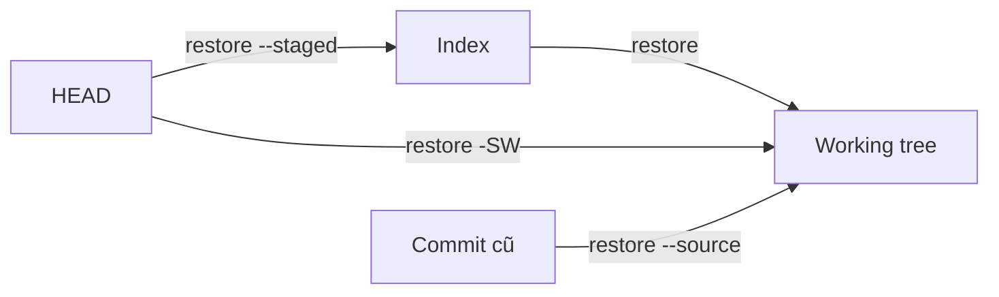
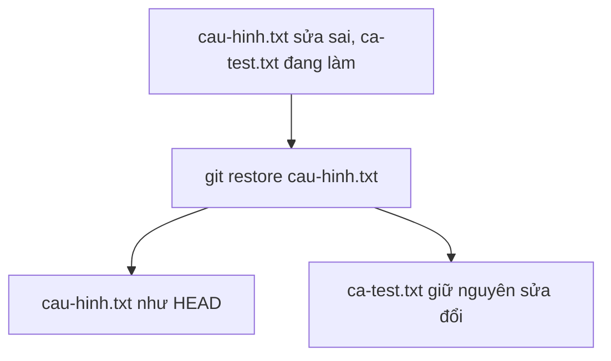

## Bạn sẽ học được gì

- Bỏ sửa đổi của đúng một tệp mà không đụng tới các tệp khác.
- Phân biệt khôi phục working tree, khôi phục index và khôi phục cả hai.
- Lấy một tệp từ commit cũ hơn HEAD.
- Nhận ra những lệnh có phạm vi quá rộng như `git restore .`.

## Khái niệm

Bạn đang sửa hai tệp. Một tệp đi đúng hướng, tệp kia bạn thử nghiệm và muốn bỏ. Các lệnh như `git reset --hard` hay `git stash` tác động tới **mọi** tệp, quá thô cho việc này. Thứ bạn cần là thao tác có **pathspec**: chỉ đích danh tệp cần hoàn tác.

`git restore` được thiết kế cho đúng việc đó. Nó chép nội dung một tệp từ một **nguồn** vào một hoặc hai **đích**:

- Đích mặc định là **working tree**. Nguồn mặc định khi đó là **index**. Vì vậy `git restore cau-hinh.txt` khi chưa stage gì sẽ đưa tệp về đúng như HEAD (vì index đang giống HEAD).
- Với `--staged`, đích là **index**, nguồn mặc định là **HEAD**. Đây là cách "unstage": bỏ tệp khỏi phần đã stage mà giữ nguyên sửa đổi trong working tree.
- Với `--staged --worktree` (viết tắt `-SW`), cả index lẫn working tree đều được ghi đè từ HEAD.
- `--source=<commit>` đổi nguồn sang commit bất kỳ, ví dụ lấy lại phiên bản của một tệp từ hai commit trước.

Điểm then chốt: chỉ những đường dẫn bạn truyền vào mới bị đụng tới. Tệp khác giữ nguyên, dù chúng đang được sửa hay đã stage.

Trước Git 2.23, cùng việc này được làm bằng `git checkout -- <tệp>` (bỏ sửa đổi) và `git reset HEAD <tệp>` (unstage). Các lệnh đó vẫn hoạt động và bạn sẽ gặp trong tài liệu cũ, nhưng `checkout` vừa chuyển nhánh vừa khôi phục tệp nên dễ nhầm; `restore` tách riêng việc khôi phục.

Một chú ý quan trọng: khôi phục working tree là **ghi đè không hỏi**. Sửa đổi chưa commit của tệp đó biến mất và không có trong reflog.

## Hình dung bằng sơ đồ





## Lệnh cần biết

```bash
git restore <tệp>                       # bỏ sửa đổi chưa stage của tệp
git restore --staged <tệp>              # unstage, giữ sửa đổi trong working tree
git restore -SW <tệp>                   # đưa cả index và working tree về HEAD
git restore --source=<commit> <tệp>     # lấy nội dung tệp từ commit khác
git restore -p <tệp>                    # chọn từng hunk để bỏ
git checkout -- <tệp>                   # cách cũ, tương đương git restore <tệp>
```

| Lệnh | Nguồn | Đích |
| --- | --- | --- |
| `git restore f` | Index | Working tree |
| `git restore --staged f` | HEAD | Index |
| `git restore -SW f` | HEAD | Index và working tree |
| `git restore --source=X f` | Commit X | Working tree |

## Ví dụ từng bước

Hai tệp đang sửa. `cau-hinh.txt` mình lỡ đặt `timeout=999`, còn `ca-test.txt` đang viết thêm ca kiểm thử và cần giữ.

```bash
git status -s
git restore cau-hinh.txt
git status -s
cat cau-hinh.txt
```

```text
 M ca-test.txt
 M cau-hinh.txt
 M ca-test.txt
timeout=60
```

Chỉ `cau-hinh.txt` quay về như HEAD. Giờ giả sử mình đã stage giá trị sai rồi mới nhận ra:

```bash
git status -s
git restore --staged cau-hinh.txt
git status -s
```

```text
 M ca-test.txt
M  cau-hinh.txt
 M ca-test.txt
 M cau-hinh.txt
```

Chữ `M` chuyển từ cột trái (index) sang cột phải (working tree): tệp được unstage, sửa đổi vẫn còn.

Lấy phiên bản của commit trước nữa (trước "Tăng timeout"):

```bash
git restore --source=HEAD~1 cau-hinh.txt
git diff cau-hinh.txt
```

```text
--- a/cau-hinh.txt
+++ b/cau-hinh.txt
@@ -1 +1 @@
-timeout=60
+timeout=30
```

(Output đã rút gọn phần header.) Chỉ working tree thay đổi; muốn đưa luôn vào index thì thêm `--staged --worktree`, khi đó `git status -s` hiện `M  cau-hinh.txt`.

Gõ sai tên tệp thì Git từ chối, không làm gì:

```text
error: pathspec 'khong-co.txt' did not match any file(s) known to git
```

## Lỗi thường gặp

**Dùng `git restore .` cho nhanh.** Dấu chấm là pathspec của cả thư mục. Trong thử nghiệm của mình, nó xóa luôn ca kiểm thử đang viết ở `ca-test.txt`. Luôn gõ đích danh tệp.

> **Cẩn thận** `git restore <tệp>` ghi đè working tree mà không hỏi, và sửa đổi bị bỏ không vào reflog. Nếu chưa chắc, chạy `git diff <tệp>` trước, hoặc `git stash push <tệp>` để cất tạm.

**Nhầm `--staged` với bỏ sửa đổi.** `--staged` chỉ đưa tệp ra khỏi index; nội dung sai vẫn nằm trong working tree.

**Dùng `git reset --hard` cho một tệp.** `reset --hard` không nhận pathspec (Git báo `fatal: Cannot do hard reset with paths.`), và nếu bỏ pathspec thì mọi tệp đều bị ảnh hưởng.

> **Mẹo** `git restore -p <tệp>` cho bạn duyệt từng hunk và chỉ bỏ những đoạn không muốn, khi một tệp có cả sửa đổi tốt lẫn xấu.

## Áp dụng trong công việc

Bạn đang viết thêm ca kiểm thử cho màn hình mở tài khoản trực tuyến, đồng thời chỉnh tạm tệp cấu hình môi trường để trỏ vào máy chủ giả lập. Trước khi commit, bạn khôi phục riêng tệp cấu hình về như HEAD để không đẩy địa chỉ máy giả lập lên, còn tệp ca kiểm thử giữ nguyên để commit.

## Chuẩn bị làm bài

Repository bài tập có hai tệp cùng đang bị sửa: một tệp cần quay về như HEAD, tệp còn lại phải giữ nguyên sửa đổi. Hãy dùng `git status -s` trước và sau để chắc chỉ tệp được yêu cầu thay đổi trạng thái, và tệp kia vẫn hiện là modified.

## Tóm tắt

- `git restore <tệp>` bỏ sửa đổi của đúng tệp đó, lấy từ index.
- `--staged` unstage; `-SW` đưa cả hai về HEAD; `--source` lấy từ commit khác.
- Pathspec quyết định phạm vi; tránh `.` khi chỉ muốn một tệp.
- Ghi đè working tree không thể hoàn tác bằng reflog.
- `git checkout -- <tệp>` là cách cũ, vẫn dùng được.
