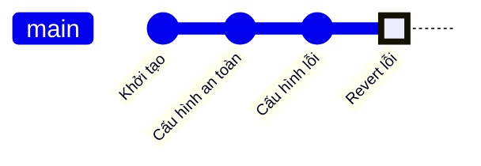
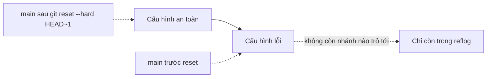

## Bạn sẽ học được gì

- Phân biệt hai cách "hoàn tác" một commit: thêm commit đảo ngược và dời nhánh lùi lại.
- Biết khi nào dùng cách nào, đặc biệt với commit đã chia sẻ cho người khác.
- Đọc commit revert và thông điệp mặc định của nó.
- Hiểu rủi ro của reset trên lịch sử đã push.

## Khái niệm

Bạn vừa phát hiện commit "Cấu hình lỗi" làm hỏng môi trường test. Có hai cách gỡ nó ra, khác nhau về bản chất.

**`git revert <commit>`** tạo một **commit mới** mang thay đổi ngược lại với commit kia. Nếu commit lỗi đổi `safe` thành `broken`, commit revert đổi `broken` thành `safe`. Lịch sử chỉ **tiến lên**: commit lỗi vẫn ở đó, commit đảo ngược nằm phía trên. Không object nào bị bỏ, không ai phải viết lại lịch sử. Vì vậy revert là cách an toàn cho mọi thứ đã push, đã nằm trên nhánh chung, đã được người khác pull về. Thông điệp mặc định có dạng `Revert "<subject cũ>"` kèm dòng "This reverts commit <hash>." để ai đọc cũng biết đây là đảo ngược của commit nào.

**`git reset <commit>`** làm việc khác hẳn: nó **dời nhánh hiện tại** về một commit cũ hơn. Các commit phía sau không còn được nhánh trỏ tới, như thể chưa từng xảy ra trên nhánh đó. Tùy chế độ (`--soft`, `--mixed`, `--hard`, bài sau), reset còn đổi index và working tree. Lịch sử bị **viết lại**: nếu bạn đã push commit lỗi, nhánh trên remote vẫn có nó, và bạn phải force push. Đồng nghiệp đã pull commit đó sẽ có lịch sử lệch với bạn.

Quy tắc ngắn gọn:

- Commit **chưa chia sẻ** (chỉ ở máy bạn): reset thoải mái, lịch sử gọn hơn.
- Commit **đã chia sẻ**: revert, để lịch sử của mọi người vẫn khớp nhau.

Revert cũng dùng được cho commit nằm sâu trong lịch sử, không chỉ commit cuối. Nếu các commit sau đã sửa cùng vùng, revert có thể conflict; xử lý như conflict merge rồi `git revert --continue`. Với `--no-commit` (`-n`), revert chỉ ghi thay đổi đảo ngược vào index và working tree để bạn gộp nhiều revert thành một commit.

Revert merge commit cần thêm `-m 1` để chỉ ra parent nào là "dòng chính"; đó là chủ đề nâng cao hơn.

## Hình dung bằng sơ đồ



Với revert, lịch sử tiến thêm một commit. Với reset, nhánh lùi lại:



## Lệnh cần biết

```bash
git revert <commit>              # tạo commit đảo ngược, mở editor cho thông điệp
git revert --no-edit <commit>    # dùng thông điệp mặc định
git revert -n <commit>           # chỉ chuẩn bị thay đổi đảo ngược, chưa commit
git revert --continue            # tiếp tục sau khi giải quyết conflict
git revert --abort               # hủy revert đang dở
git reset --hard <commit>        # dời nhánh, bỏ index và working tree (cẩn thận)
git reflog                       # tìm lại vị trí cũ nếu reset nhầm
```

| | `git revert` | `git reset` |
| --- | --- | --- |
| Lịch sử | Thêm commit mới | Dời nhánh lùi |
| Commit lỗi | Vẫn còn trong lịch sử | Không còn trên nhánh |
| An toàn với nhánh đã push | Có | Cần force push, ảnh hưởng người khác |
| Hợp với | Nhánh chung, production | Commit local chưa chia sẻ |

## Ví dụ từng bước

Lịch sử có commit lỗi ở đầu:

```bash
git log --oneline
```

```text
2b3486a Cấu hình lỗi
3ccbcef Cấu hình an toàn
7e1e491 Khởi tạo
```

Đảo ngược bằng revert:

```bash
git revert --no-edit HEAD
git log --oneline
cat config.txt
```

```text
[main 91a4204] Revert "Cấu hình lỗi"
 1 file changed, 1 insertion(+), 1 deletion(-)
91a4204 Revert "Cấu hình lỗi"
2b3486a Cấu hình lỗi
3ccbcef Cấu hình an toàn
7e1e491 Khởi tạo
safe
```

(Output đầu đã lược một dòng `Date:`.) Nội dung trở lại `safe`, lịch sử có thêm một commit. Thông điệp đầy đủ:

```bash
git log -1 --format=%B
```

```text
Revert "Cấu hình lỗi"

This reverts commit 2b3486aa74d1c618c042f51795e100e3a4909fdd.
```

So sánh với reset trên cùng tình huống ban đầu:

```bash
git reset --hard HEAD~1
git log --oneline
```

```text
HEAD is now at 3ccbcef Cấu hình an toàn
3ccbcef Cấu hình an toàn
7e1e491 Khởi tạo
```

Nội dung tệp giống nhau, nhưng lịch sử thì không: commit lỗi đã rời khỏi nhánh.

## Lỗi thường gặp

**Reset commit đã push.** Lần push sau bị từ chối vì nhánh local "đi sau" remote. Force push thì đè lên nhánh chung. Nếu đã chia sẻ, quay lại dùng revert.

> **Cẩn thận** `git reset --hard` xóa luôn thay đổi chưa commit trong working tree, và phần này không có trong reflog. Kiểm tra `git status` trước khi chạy.

**Revert nhầm commit.** Revert chính commit revert (revert của revert) là cách đưa thay đổi trở lại. Lịch sử vẫn minh bạch.

**Revert rồi không hiểu vì sao merge lại nhánh cũ không mang thay đổi vào.** Sau khi revert, Git coi các commit gốc đã được merge; muốn đưa lại, revert commit revert.

> **Mẹo** Dùng `git revert -n` cho nhiều commit liên tiếp, rồi commit một lần với thông điệp giải thích, để lịch sử không có năm commit revert rời rạc.

## Áp dụng trong công việc

Sáng thứ sáu, một commit đổi URL môi trường trong cấu hình test đã được merge vào `main` và pipeline đêm qua đỏ toàn bộ. Nhiều người đã pull `main`. Bạn chạy `git revert --no-edit <hash>`, push commit revert, pipeline xanh lại. Commit gốc vẫn nằm trong lịch sử để người viết xem lại và sửa đúng cách, không ai phải xử lý lịch sử bị viết lại.

## Chuẩn bị làm bài

Bài thực hành có một commit cuối làm hỏng tệp cấu hình. Bạn cần đưa nội dung trở về trạng thái an toàn bằng một commit mới, không xóa commit nào khỏi lịch sử, và giữ working tree sạch. Câu hỏi hỏi lệnh phù hợp để đảo thay đổi đã chia sẻ mà vẫn giữ lịch sử. Hãy:

- Xem `git log --oneline` để biết số commit trước khi làm.
- Nhớ rằng nếu không có tùy chọn, editor sẽ mở cho thông điệp.
- Sau khi xong, số commit phải tăng thêm một và tệp cấu hình mang giá trị an toàn.

## Tóm tắt

- `git revert` thêm commit đảo ngược; lịch sử chỉ tiến lên.
- `git reset` dời nhánh lùi; lịch sử của nhánh bị viết lại.
- Commit đã chia sẻ: revert. Commit chỉ ở local: reset cũng được.
- Revert có thể conflict; xử lý rồi `--continue`.
- `reset --hard` còn xóa thay đổi chưa commit, hãy kiểm tra trước.
