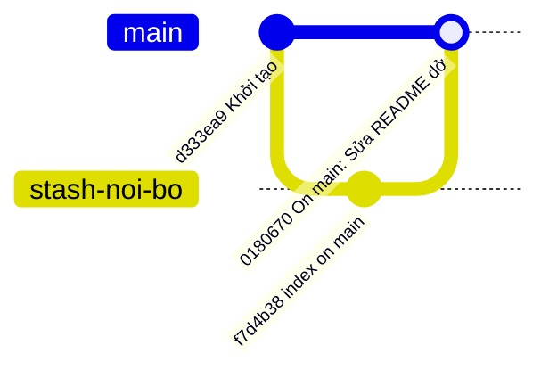
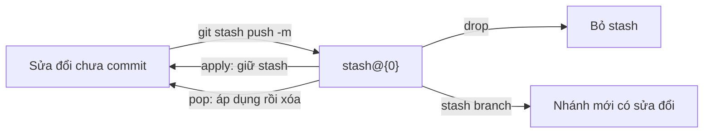

## Bạn sẽ học được gì

- Cất sửa đổi chưa commit để có working tree sạch, rồi lấy lại sau.
- Đặt tên cho stash và quản lý nhiều stash cùng lúc.
- Phân biệt `apply`, `pop`, `drop` và biết khi nào stash được giữ lại.
- Hiểu stash lưu ở đâu và nó không cất những gì theo mặc định.

## Khái niệm

Bạn đang sửa dở thì có việc gấp: cần chuyển nhánh để chạy lại một test, hoặc cần pull bản mới. Commit nửa vời thì làm bẩn lịch sử; bỏ sửa đổi thì tiếc. **Stash** là chỗ cất tạm: Git gói sửa đổi chưa commit lại, đưa working tree và index về như HEAD, và cho bạn lấy chúng ra sau.

Bên dưới, stash là **commit thật**, chỉ không nằm trên nhánh nào. Mỗi lần `git stash push`, Git tạo:

- một commit ghi lại **index** lúc đó ("index on main: ..."),
- một commit ghi lại **working tree**, có hai parent là HEAD và commit index ở trên ("On main: <thông điệp>"),
- và nếu dùng `-u`, thêm một commit thứ ba chứa tệp untracked.

Ref `refs/stash` trỏ tới stash mới nhất; các stash cũ hơn được giữ trong reflog của ref đó. Vì vậy chúng có tên dạng `stash@{0}`, `stash@{1}`: chính là cú pháp reflog bạn đã gặp.

Mặc định stash **chỉ cất tệp đã được theo dõi** (tracked), cả phần đã stage lẫn chưa stage. Tệp untracked ở lại working tree, tệp bị ignore cũng vậy. Muốn cất cả tệp untracked, thêm `-u`; muốn cất cả tệp bị ignore, dùng `-a`.

Lấy lại có hai cách. `apply` áp dụng stash vào working tree và **giữ** stash trong danh sách. `pop` áp dụng rồi **xóa** stash, nhưng chỉ khi áp dụng thành công: nếu có conflict, stash được giữ lại để bạn không mất gì. `drop` xóa một stash mà không áp dụng.

Mặc định, khi áp dụng, phần đã stage lúc cất sẽ trở thành sửa đổi chưa stage. Nếu muốn khôi phục cả trạng thái index, thêm `--index`.

## Hình dung bằng sơ đồ



Sơ đồ trên mô phỏng cấu trúc stash: `stash-noi-bo` không phải nhánh thật, chỉ để thể hiện commit index; commit stash là commit hai parent. Thật ra `main` không dời đi; `refs/stash` mới trỏ vào commit `0180670`.



## Lệnh cần biết

```bash
git stash push -m "<mô tả>"        # cất tracked, có tên
git stash push -u -m "<mô tả>"     # cất cả untracked
git stash push <tệp>               # chỉ cất một số tệp
git stash list                     # danh sách stash
git stash show [-p] stash@{n}      # xem tóm tắt hoặc diff
git stash show --include-untracked stash@{n}
git stash apply [--index] stash@{n}
git stash pop                      # áp dụng stash mới nhất rồi xóa
git stash drop stash@{n}
git stash branch <tên> [stash@{n}] # tạo nhánh từ commit gốc rồi áp dụng
```

| Lệnh | Áp dụng | Xóa stash |
| --- | --- | --- |
| `apply` | Có | Không |
| `pop` | Có | Có, nếu không conflict |
| `drop` | Không | Có |
| `branch` | Có, trên nhánh mới | Có, nếu thành công |

## Ví dụ từng bước

README đang sửa dở, và có một tệp nháp chưa từng add:

```bash
git status -s
git stash push -m "Sửa README dở"
git status -s
```

```text
 M README.md
?? nhap.txt
Saved working directory and index state On main: Sửa README dở
?? nhap.txt
```

`nhap.txt` vẫn còn, vì nó untracked. Lần tiếp theo mình sửa `app.txt` và dùng `-u`:

```bash
git stash push -u -m "Thử app và nháp"
git status -s
git stash list
```

```text
Saved working directory and index state On main: Thử app và nháp
stash@{0}: On main: Thử app và nháp
stash@{1}: On main: Sửa README dở
```

Lần này working tree sạch hẳn (`git status -s` không in gì). Xem nội dung một stash:

```bash
git stash show stash@{0}
git stash show --include-untracked stash@{0}
```

```text
 app.txt | 1 +
 1 file changed, 1 insertion(+)
 app.txt  | 1 +
 nhap.txt | 1 +
 2 files changed, 2 insertions(+)
```

Lấy lại stash mới nhất và xóa nó; Git in trạng thái rồi dòng cuối (output rút gọn):

```bash
git stash pop
```

```text
	modified:   app.txt
	nhap.txt
Dropped refs/stash@{0} (92fda3198e1740b83083f56f59cd368f348f39b3)
```

Nếu tệp đã bị thay đổi theo hướng khác kể từ khi cất, `pop` gặp conflict và giữ stash lại (repo thử khác):

```text
CONFLICT (content): Merge conflict in README.md
The stash entry is kept in case you need it again.
```

## Lỗi thường gặp

**Tưởng stash cất cả tệp mới.** Tệp untracked ở lại nếu không có `-u`. Khi chuyển nhánh, chúng đi theo bạn sang nhánh khác.

**Chồng chất stash không tên.** Sau vài ngày, danh sách toàn "WIP on main" rất khó phân biệt. Luôn dùng `-m`.

> **Lưu ý** Khi `pop` gặp conflict, stash vẫn còn trong danh sách. Sửa conflict xong, nhớ `git stash drop` để không áp dụng nhầm lần nữa.

**Drop nhầm stash.** Git in hash khi drop (`Dropped refs/stash@{0} (...)`). Còn hash đó thì `git stash apply <hash>` vẫn lấy lại được; mất hash thì tìm bằng `git fsck --lost-found`.

> **Mẹo** Stash áp dụng mãi không được vì nhánh đã thay đổi quá nhiều? `git stash branch <tên>` tạo nhánh mới từ đúng commit lúc bạn cất, nên áp dụng luôn sạch.

## Áp dụng trong công việc

Bạn đang viết dở kịch bản kiểm thử cho màn hình nạp tiền điện thoại thì trưởng nhóm nhờ chạy lại gấp bộ test hồi quy trên `main` để xác nhận một hotfix. Bạn stash với tên mô tả rõ, chuyển sang `main`, chạy test, báo kết quả, rồi quay về nhánh cũ và `pop` để làm tiếp như chưa từng gián đoạn.

## Chuẩn bị làm bài

Repository bài tập có một tệp đang bị sửa. Bạn cần cất sửa đổi đó để working tree sạch, và phải có ít nhất một stash trong danh sách. Đặt một thông điệp mô tả tùy ý. Kiểm tra bằng `git status` và `git stash list` sau khi làm.

## Tóm tắt

- Stash cất sửa đổi chưa commit vào commit riêng, trỏ bởi `refs/stash`.
- Mặc định chỉ cất tệp tracked; `-u` thêm untracked, `-a` thêm ignored.
- `apply` giữ stash, `pop` xóa sau khi áp dụng thành công, `drop` chỉ xóa.
- Luôn đặt tên bằng `-m` và dọn stash cũ.
- `git stash branch` cứu stash không còn áp dụng sạch.
